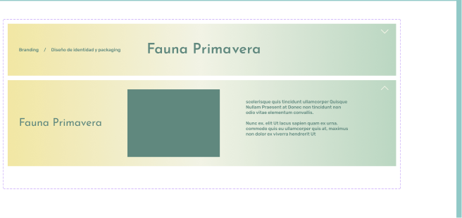
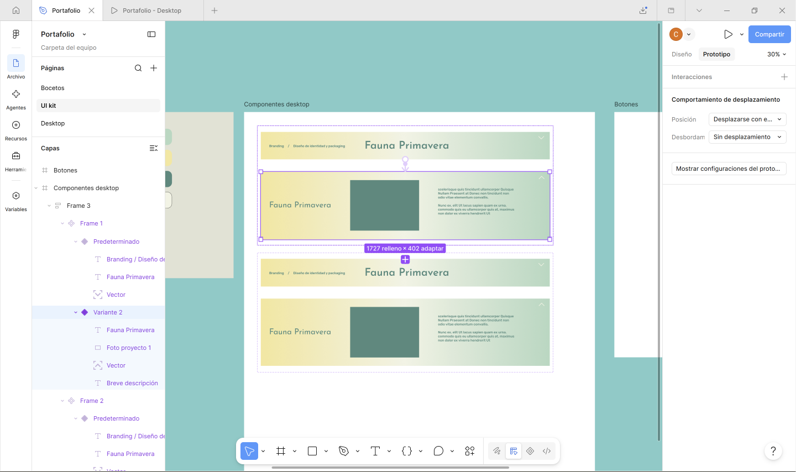

# Bitácora Portafolio Camila Canales (entrega 23-11)


### Link al figma 

```html
<div
href="https://www.figma.com/design/dssT2i0NDOggudRLQppDGw/Portafolio-Camila-Canales?node-id=26-3&t=QcQDGNExu0EFaa1D-1"
>
```
### Link GitHub Pages

```html
<div
href="https://caamiii.github.io/Camila_Canales_Portafolio/"
>
```


**Recursos usados:**
- **Figma:** para el diseño.
- **Chatgpt:** para consultas rápidas.
- **Claude (Anthropic):** conectada al archivo de Figma, para ayuda con los codigos Css, como contraparte para corrección, resolver las interacciones más difíciles y optimizar el sitio.
- **Material de apoyo entregado en clases**: guia para el HTML y consultar dudas acerca de códigos.
---

### Descripción proyecto

- Recopilación de proyectos que reflejan mi proceso creativo dentro del diseño. Me gusta entender el diseño como un espacio para explorar, experimentar y dar forma a nuevas ideas. Me interesa buscar distintas maneras de comunicar un concepto, descubrir posibilidades a través de los recursos visuales y encontrar en los detalles una oportunidad para aportar algo diferente. Disfruto involucrarme en los procesos creativos, probar, cuestionar y descubrir nuevas soluciones. Me motiva crear propuestas que tengan una intención detrás y que reflejen una mirada propia. 


### Webs de referencia

**1.Petrillo Studio**
```html
<div
href="https://petrillo.studio/?ref=onepagelove"
>
```
- Rescate: Animaciones de navegación y transiciones entre secciones. 
Me interesa la manera en que el sitio utiliza animaciones para sus distintas secciones, haciendo que la navegación se sienta más dinámica y fluida. En lugar de presentar cada apartado como un contenido independiente, los cambios entre secciones generan una continuidad visual que permite recorrer la página de una forma más atractiva e interactiva.

Rescato especialmente cómo los elementos visuales van cambiando y transformándose a medida que se avanza por el sitio, utilizando el movimiento como un recurso que acompaña la navegación y ayuda a generar una experiencia más envolvente. Estas transiciones permiten que el usuario no solo pase de una sección a otra, sino que también descubra el contenido a través de pequeñas interacciones que mantienen su interés durante el recorrido.

Me gustaría incorporar este tipo de recurso en mi portafolio, utilizando animaciones sutiles que acompañen el paso entre categorías y proyectos. Busco que la navegación tenga movimiento y personalidad, pero que al mismo tiempo sea intuitiva y no distraiga de lo más importante: los trabajos que se presentan.


**2.Rendez-vous Frandeclat**

```html
<div
href="https://rendez-vous.franceclat.fr/?ref=onepagelove"
>
```
- Rescate: Estructura para los contenidos.
Me interesa la manera en que el sitio organiza y distribuye la información de contenido en distintas secciones que permiten comprender fácilmente de qué trata cada una. A pesar de presentar mucha información, utiliza una estructura clara y ordenada, donde cada apartado tiene su propio espacio y jerarquía, facilitando la lectura y evitando que todo se vea saturado.

También rescato la forma en que combina distintos tipos de contenido, como imágenes, textos descriptivos, y elementos interactivos.Esto permite que cada contenido tenga una forma de presentación acorde a lo que se quiere comunicar.

Me gustaría aplicar esta lógica en mi portafolio, organizando mis proyectos por categorías y dando a cada uno un espacio donde pueda mostrar sus imágenes y explicar brevemente su desarrollo. Busco que la información tenga una jerarquía clara, que sea fácil de recorrer y que permita al usuario explorar los trabajos sin encontrarse con demasiada información al mismo tiempo.

**3.Sophia Denison**

```html
<div
href="https://www.behance.net/gallery/239914389/Portfolio-of-Selected-Works-2024-2025"
>
```
- Rescate: Estructura para presentar los proyectos 
Me interesa la forma en que se organiza la presentación de cada proyecto, utilizando composiciones que permiten conocer el trabajo desde distintas perspectivas. No se limita a mostrar una imagen del resultado final, sino que desarrolla visualmente cada propuesta, incorporando fotografías, detalles, aplicaciones y distintas vistas que ayudan a comprender mejor lo que se realizó.

También rescato cómo se combinan imágenes de diferentes tamaños y formatos, alternando entre composiciones más amplias, que permiten apreciar el proyecto en su totalidad, y acercamientos que destacan detalles específicos. Esta variedad hace que la presentación sea más dinámica y evita que todos los proyectos se vean iguales, manteniendo una continuidad visual sin perder la identidad de cada propuesta.

Me gustaría aplicar esta estructura en mi portafolio, dando a cada proyecto un recorrido visual propio que permita mostrar sus diferentes aplicaciones y características. De esta manera, cada proyecto puede entenderse como una propuesta completa y no solamente como una imagen final.


**4.Arina Grishunina**

```html
<div
href="https://www.behance.net/gallery/252938105/PORTFOLIO-2026"
>
```
- Rescate: Familia tipográfica para títulos con estética de timbre.
Me interesa especialmente el estilo tipográfico utilizado en los títulos, ya que sus formas recuerdan a las letras de los timbres , con una apariencia ligeramente irregular y una personalidad visual muy marcada. Este recurso genera una sensación más artesanal y espontánea, alejándose de las tipografías convencionales y aportando un carácter propio a la composición.

También rescato cómo esta tipografía se utiliza como un elemento gráfico y no solamente como un recurso para transmitir información. Sus formas y su apariencia funcionan como parte de la identidad visual del portafolio, ayudando a generar una estética reconocible y aportando contraste frente a otros elementos más limpios y ordenados. Además, permite destacar los títulos y establecer una jerarquía visual dentro de las distintas secciones.

Me gustaría incorporar este tipo de lenguaje tipográfico en mi portafolio, especialmente en los títulos de los proyectos y títulos más grandes. Busco una tipografía con personalidad, que se sienta un poco más manual y experimental, y que pueda complementar la presentación de mis proyectos sin dificultar la lectura. Así me ayudaría a construir una identidad visual propia para mi portafolio.

---

### ¿Qué hice en el sitio?

- Diseñé en Figma la versión desktop del sitio, su **home**, sus **proyectos** y su versión mobile.
- Vi la tipografía y sus estilos, los componentes con sus variantes, íconos, animaciones, distribución, diseño y correcciones de mejoras.
- Realice los códigos HTML siguiendo el orden del material de apoyo y consultando de aquello que no tenia conocimiento.
- Con apoyo de la IA, pasé el diseño a CSS teniendolo como contraparte de lo que me faltaba completar y sus correcciones. Utilice JavaScript para elementos como el carrusel,efectos visuales de las alas de las fotos, el menú que se despliega en los trabajos, la tarjeta que aparece al momento de hacer clic en contacto y que se copie el contacto, los videos y la rueda de sigue explorando interactiva, ya que investigando, la IA me dijo que era mejor trabajar esos elementos con Js para tener un mayor control y que quedaran lo más parecidas al diseño en figma.
- Subi imagenes e iconos correctamente.


### Correciones Revisión en clases

- Mejore la redacción de la descripción del proyecto, siendo más personal.
- Detalle más los rescates de los referentes que tenía.
- Agregue el componente que se me sugirió al final de cada proyecto para que la persona siempre siga explorando y no tenga que necesariamente irse al home para poder ver otro proyecto.
- Agregue en el menú, en los trabajos, un despliegue de una lista en la que se muetran todos los trabajos que tiene la web. 
- Aplique más criterio de diseño ya que en un inicio me costo ver como quería que fuera mi portafolio, lo que sentía que me representaba, ya que me estaba quedando muy vacío y monotono a mi gusto.
- Resolvi las dudas que tenía en la última corrección: " **¿Cómo hacer la interacción de los trabajos que hice en figma en códigos** **¿Cómo hacer los títulos con ese efecto timbre?**. Esta ultima la descarte ya que la manera que encontre de hacerla seria poner el título como imagen pero eso no era lo más óptimo para un sitio web.


### ¿Qué dificultades tuve y cómo las resolví?

### Consulta: © copyright o derechos de autor    

> ¿Qué significa cuando aprece esa "© " al lado de un nombre? 

**Respuesta de la IA (resumen):** El símbolo © significa copyright (o derechos de autor en español).
Cuando aparece junto a un nombre, indica que esa persona es la creadora o propietaria legal de la obra (ya sea una fotografía, ilustración, texto o diseño) y que tiene los derechos exclusivos sobre ella.

¿Qué implica esto en la práctica?

• Protección legal: La obra está protegida por las leyes de propiedad intelectual.
• Permisos necesarios: No puedes copiar, distribuir, modificar ni utilizar esa imagen o contenido con fines comerciales (o incluso en ciertos usos públicos) sin el permiso previo de su autora.
• Reconocimiento: Sirve como un aviso público para identificar quién tiene la titularidad de la obra, aunque la protección legal suele existir desde el momento mismo en que se crea el trabajo.

### Consulta: Acordeón en figma (primer diseño propuesto)

> ¿Cómo hacer esto en figma? 
<video width="100%" controls>
  <source src="Acordeón.mp4" type="video/mp4">
 </video>

**Respuesta de la IA (resumen):** Para recrear este acordeón interactivo con efecto hover en Figma, debes usar Componentes interactivos (Variantes) y Auto Layout. Aquí tienes el paso a paso:

1. Crear la tarjeta base (Estado cerrado)

1. Crea el encabezado: Escribe el título principal, selecciónalos y presiona Shift + A para crear un Auto Layout horizontal (nómbralo Header).
2. Prepara el contenido oculto: Escribe los textos secundarios  y agrúpalos en otro Auto Layout vertical (nómbralo Detalles).
3. Une todo en la tarjeta: Selecciona Header y Detalles, presiona Shift + A para crear un Auto Layout vertical principal (nómbralo Card).
	• Aplica el relleno con degradado lineal (de naranja/rojo a la izquierda hacia blanco a la derecha).
	• Configura el ancho como Fill container y el alto en Hug contents.
4. Oculta los detalles: Selecciona la capa Detalles dentro de la tarjeta y haz clic en el ícono del ojo para ocultarla (en Auto Layout, ocultar una capa colapsa su espacio automáticamente).

2. Configurar las variantes (Estado abierto / Hover)

1. Selecciona la tarjeta Card y haz clic arriba en Create component (Ctrl + Alt + K o Cmd + Option + K).
2. Con el componente seleccionado, haz clic en Add variant (el ícono + en la barra superior o panel derecho) para crear una segunda versión.
3. En esta segunda variante:
	• Vuelve a activar el ícono del ojo en la capa Detalles para hacerla visible.
	• Cambia el color del fondo a un tono beige o crema claro uniforme.
	• Cambia el color de todos los textos a naranja/rojo.

3. Conectar la interacción

1. Cambia a la pestaña Prototype en el panel derecho.
2. Arrastra el nodo azul desde la Variante 1 (cerrada) hacia la Variante 2 (abierta).
3. Configura el disparador (Trigger) como While hovering (Mientras el cursor está encima).
4. En animación, selecciona Smart animate, tipo Ease out, con una duración de 300ms para que el despliegue y el cambio de color sean suaves.

4. Armar la lista completa

1. Ve a la pestaña Assets (panel izquierdo), arrastra tu componente a tu mesa de trabajo y duplícalo 5 veces.
2. Selecciona las 5 copias, presiona Shift + A para meterlas en un Auto Layout vertical con 0px de espacio entre ellas.
3. Edita los textos de cada fila y dale a Play (Present) para probar cómo se expanden al pasar el mouse.


> yo los tenia creados así esta mal?


**Respuesta de la IA (resumen):** ¡Para nada, vas por muy buen camino! Ya tienes lo más importante: el componente con sus dos variantes (estado cerrado arriba y abierto abajo) dentro del marco punteado.
Para que te funcione igual de fluido que en el video de referencia y no se desordene al poner varios proyectos uno debajo del otro, solo debes revisar tres detalles clave en tu diseño:

El alto de las variantes (Auto Layout)

En tu imagen, ambas variantes parecen tener casi la misma altura y un espacio vacío grande arriba y abajo.
• Qué ajustar: Asegúrate de que ambas variantes tengan Auto Layout activo y su alto configurado en Hug contents (Abrazar contenido).
• Por qué: Así, la variante cerrada será delgada (solo lo que mide el título) y, al expandirse, crecerá de forma natural para mostrar la imagen y el texto, empujando hacia abajo las tarjetas siguientes en lugar de dejar espacios en blanco.

> no me esta empujando hacia abajo las tarjetas siguientes, como que quedan sobrepuestas


**Respuesta de la IA (resumen):** ¡Ajá! Con esta captura se ve clarísimo el problema. Fíjate en dos detalles importantes en tu panel de capas (a la izquierda):
1. Estás viendo los componentes maestros, no las copias (instancias):
En tu mesa de trabajo Componentes desktop tienes metidos los componentes originales (los que tienen el ícono de los 4 rombos rellenos ❖ llamados Frame 1 y Frame 2) dentro de un Frame 3. Los componentes maestros nunca se usan directamente dentro del diseño de la página; funcionan como "moldes".
2. Solo necesitas UN componente maestro:
Creaste un componente maestro (Frame 1) para el primer proyecto y otro componente maestro diferente (Frame 2) para el segundo. No hace falta crear un componente nuevo para cada proyecto.

Cómo solucionarlo en 4 pasos rápidos:

1. Borra Frame 2: Quédate únicamente con Frame 1 (ese será tu único molde maestro para todos los proyectos de tu portafolio) y sácalo de Frame 3 para dejarlo suelto en tu página de UI kit.
2. Ve a tu página Desktop (arriba a la izquierda, debajo de UI kit en la sección Páginas).
3. Inserta copias (instancias) desde Recursos:
	• Haz clic en el ícono de Recursos (el cuadrado con círculos y triángulos en la barra izquierda, debajo de Agentes) o ve a la pestaña de activos y arrastra Frame 1 hacia tu diseño en Desktop.
	• Verás que en el panel de capas esta copia tiene un rombo hueco (◇), no 4 rombos rellenos.
	• Duplica esa copia (Ctrl + D) tantas veces como proyectos tengas (3, 4 o 5 veces) y edita los textos y fotos directamente en cada copia.
4. Agrupa las copias con Auto Layout:
	• Selecciona todas esas copias de rombo hueco (◇) en tu página Desktop y presiona Shift + A.
	• Asegúrate de que ese grupo tenga el Flujo vertical (flecha hacia abajo) y altura Ajustar al contenido.
Cuando le des a Play desde tu página Desktop, verás que ahora sí se empujan perfectamente hacia abajo sin encimarse.

### Consulta: Css (primer diseño propuesto)
> puedes darme los códigos en css para la el home en desktop y proyecto 1, solo usa flexbox, unidades rem y %, estructura con `header`, `main` y `footer` semántica, no uses grid*, position ni frameworks.

**Respuesta de la IA (resumen):**
- Creó `estilos.css` hasta donde tengo desarrollado

### Consulta Agente en figma: Mejorar componente interactivo (diseño final)

>necesito que lo agrandes en tamaño como al triple y que además lo dejes interactivo, donde vaya avanzando y si el usuario pasa el cursor por el nombre pueda seleccionarlo y lo lleve a otra pantalla

**Respuesta de la IA (resumen):** Encontré Proyecto 1 al 6 en la página Desktop. La rueda tiene siete nombres y está en UI kit; prepararé una copia interactiva en Desktop para poder conectarla con esas pantallas.

> que los textos tengan los nombres: Fauna Primavera, Copao Ao, Nespoon, Buen Lugar, Morfis y Cromía del Elqui. Además irá una rueda en cada pantalla de proyecto por lo cual necesito que si se pone en la que tiene el proyecto corra con solo los siguientes proyectos para que el usuario nunca deje de navegar por los proyectos.

**Respuesta de la IA (resumen):** Voy a usar esos seis nombres y añadir una rueda en cada proyecto. Cada una mostrará solo los otros cinco, en ciclo, con resaltado al pasar el cursor y navegación al hacer clic. Ya preparé las seis ruedas: cada una excluye su propio proyecto y se pausa al entrar con el cursor. Ahora las colocaré al final de cada pantalla, conservando el contenido existente.


### Consulta: poner capas una encima de otra sin `position`

> ¿Cómo pongo texto encima de un video o de una foto si no puedo usar `position`?

**Respuesta de la IA:** con una "pila" de flexbox. Todos los hijos miden el 100% del ancho y, desde el segundo en adelante, se corren hacia atrás con un margen negativo de 100%. Así quedan uno sobre otro, y el orden de las capas se controla con `z-index`, que sí funciona en los elementos de un contenedor flex.

```css
.apilado { display: flex; overflow: hidden; }
.apilado > * { flex: 0 0 100%; min-width: 0; }   /* cada capa ocupa todo el ancho */
.apilado > * + * { margin-left: -100%; }          /* las siguientes se montan sobre la primera */
```
```html
<header class="portada apilado">
  <video class="alas__medio">…</video>          <!-- capa 0: el video -->
  <span class="alas__brillo"></span>            <!-- capa 1: el brillo -->
  <div class="portada__contenido">…</div>       <!-- capa 3: menú y título -->
</header>
```

**Qué se corrigió:** 
- En mobile la imagen de fondo de "Sobre mí" no cubría toda la sección. Se arregló con `height: auto; align-self: stretch`, para que la imagen se estire al alto del contenido.

**Qué se aceptó:** 
- La técnica completa. Se usa en las portadas de cada proyecto, en "Sobre mí", en el carrusel y en los títulos.


### Consulta: Carrusel de proyectos

> Necesito que el carrusel se mueva como en el prototipo de Figma, con el efecto de vidrio y las fotos que se unen en el borde izquierdo.

**Respuesta de la IA:** se construye en cuatro partes.

1. **Las fotos:** son elementos de 630 × 354 px (`39.375rem × 22.125rem`) con `border-radius: 12.5rem` y `overflow: hidden`. La foto adentro usa `object-fit: cover` para llenar la píldora sin deformarse.
2. **El movimiento infinito:** la lista de fotos se escribe **dos veces** seguidas en el HTML. La animación mueve la pista hasta `-50%`, que es exactamente una lista completa. En ese momento la animación vuelve a 0 y, como la segunda copia es igual a la primera, el salto no se nota. El Figma avanza de a una foto con pausas, así que la animación tiene 8 pasos (cada paso es 6.25% = 50% / 8) con la misma curva de aceleración del prototipo:

   ```css
   .carrusel__pista { display: flex; gap: 0.875rem; animation: carrusel 24s infinite; }
   .carrusel:hover .carrusel__pista { animation-play-state: paused; } /* se detiene con el cursor */

   @keyframes carrusel {
     0%, 8%       { transform: translateX(0); }
     12.5%, 20.5% { transform: translateX(-6.25%); }   /* avanza una foto y espera */
     /* … sigue igual hasta … */
     100%         { transform: translateX(-50%); }
   }
   ```

3. **El vidrio de cada píldora:** una capa encima de la foto. Combina un brillo en la esquina superior izquierda (la luz a −45° del Figma), sombras internas rosadas y verdes que imitan la dispersión de color, y un desenfoque que **solo actúa en el borde** gracias a una máscara:

   ```css
   .carrusel__vidrio {
     margin-left: -100%;                       /* se monta sobre la foto */
     box-shadow: inset 0.4rem 0.4rem 0.9rem rgba(255,255,255,.75),
                 inset -0.4rem -0.4rem 0.9rem rgba(243,221,228,.6);
     backdrop-filter: blur(0.4rem);            /* desenfoca lo que hay detrás */
     mask-image: radial-gradient(ellipse at center, transparent 58%, #000 100%); /* solo en el borde */
   }
   ```

4. **Las píldoras que "se unen" en el borde izquierdo:** en el Figma, la capa de vidrio deforma la imagen justo en su borde izquierdo. Se imita con una franja de 12rem que desenfoca lo que pasa por detrás y se desvanece hacia la derecha. Cuando las píldoras llegan ahí, se funden entre ellas:

   ```css
   .carrusel__union {
     flex: 0 0 12rem;
     margin-right: -12rem;                     /* no ocupa espacio, se monta sobre la pista */
     backdrop-filter: blur(1.1rem) saturate(1.3);
     mask-image: linear-gradient(90deg, #000 35%, transparent 100%);
   }
   ```

**Qué se corrigió:** 
- Faltaba el vidrio en la primera versión del componente, y en la segunda faltaba la unión del borde izquierdo. Las dos se agregaron después de correcciones mías con el Figma.

**Qué se aceptó:** 
- Las fotos duplicadas ya que se repetian, los pasos con pausa y la pausa al pasar el cursor en caso de que el usuario quiera detener para ver la foto.


### Consulta: Cursor en forma de mariposa

- Quiero que el cursor tenga forma de mariposa cuando se navege por la web en todo momento, con borde verde y relleno rosado en un tamaño no tan pequeño.¿Como lo hago?, quiero utilizar el mismo ícono que ya estoy usando en la banda "about me".

**Respuesta de la IA:** CSS permite usar una imagen como cursor con `cursor: url(...)`. Los dos números indican el punto exacto que "hace clic" (aquí el centro de una imagen de 44 px), y `auto` es el cursor de respaldo si la imagen no carga. Se aplica a todos los elementos con `*` para que no cambie a la manito sobre los enlaces.

```css
*, *::before, *::after {
  cursor: url("../assets/img/iconos/cursor-mariposa.png") 22 22, auto;
}
```

**Qué se corrigió**
- La primera versión que generó fue la mariposa verde de "about me" tal como se lo pedí pero no se veía sobre fondos oscuros y se notaba poco.
- Así que pedí que guera de borde verde, relleno rosado y un tamaño mayor. La IA dibujó una mariposa minimalista nueva (en SVG) y la convirtió a PNG de 44 px.

**Qué se aceptó:** 
- El cursor que se generó al final en vez de usar el ícono del about me.


### Consulta: Efecto de luz en las alas (portadas proyectos, video del home y fondo de "Sobre mí")

> Necesito que las fotos de las mariposas y el video del home tengan una transparencia interactiva, como si pasará una luz en las alas. Manten el efecto de ruido que esta creado en el figma y mantenlas en un menor contraste sin ese brillo o luz que a veces tienen para que se lea mejor el título.

**Respuesta de la IA:** se combinan cuatro efectos sobre la técnica de capas.

1. **Brillo tornasol que recorre la imagen siempre:** una capa con un degradé diagonal (rosa, blanco, verde y amarillo) que una animación mueve de izquierda a derecha. `mix-blend-mode: soft-light` hace que se mezcle con la foto en vez de taparla.

   ```css
   .alas__brillo {
     mix-blend-mode: soft-light;
     background-image: linear-gradient(115deg, transparent 30%, rgba(243,221,228,.55) 42%,
                       rgba(255,255,255,.8) 48%, rgba(175,216,192,.55) 54%, transparent 72%);
     animation: brillo-alas 7s ease-in-out infinite;
   }
   @keyframes brillo-alas { from { transform: translateX(-100%); } to { transform: translateX(100%); } }
   ```

2. **Transparencia que sigue al cursor:** JavaScript calcula dónde está el mouse (en %) y lo guarda en dos variables CSS, `--x` y `--y`. El CSS usa esas variables en una máscara circular que vuelve semitransparente la zona bajo el cursor, como un ala de vidrio.

   ```js
   zona.addEventListener("pointermove", function (evento) {
     var caja = zona.getBoundingClientRect();
     zona.style.setProperty("--x", ((evento.clientX - caja.left) / caja.width) * 100 + "%");
     zona.style.setProperty("--y", ((evento.clientY - caja.top) / caja.height) * 100 + "%");
   });
   ```
   ```css
   .alas__medio {
     mask-image: radial-gradient(circle at var(--x, 50%) var(--y, 50%),
                 rgba(0,0,0, var(--transparencia, 1)) 0%, #000 var(--radio, 0%));
   }
   .alas:hover { --transparencia: 0.6; --radio: 20%; }   /* solo al pasar el cursor */
   ```

3. **Ruido del Figma:** una textura de puntos rosados que se repite encima de la foto (`background-image` + `mix-blend-mode`). Así el grano se mantiene aunque el ala se vuelva translúcida.
4. **Menos luz en las portadas:** un `filter: brightness(0.82) contrast(0.88)` sobre la foto, para que el título crema se lea bien.

**Qué se corrigió**
- El ruido se perdía en las zonas translúcidas, así que se agregó la capa de ruido.
- A las portadas se les bajó el brillo.
- La luz del cursor era mucha y molestaba, así que se pasó de transparencia 0.35 a 0.6 y de radio 26% a 20%.

**Qué se aceptó:**
- El brillo que generó que recorre la imagen y la transparencia con el cursor.


### Consulta: Menú de "Trabajos" que despliega la lista de proyectos

- Me gustaría que al poner el cursor sobre "Trabajos" en el menú del home, se despliegue la lista de proyectos con enlaces que te redirijan a los proyectos.

**Respuesta de la IA:** la lista (`ul.submenu`) estaría dentro del mismo `li` que "Trabajos" y partiría oculta con `display: none`. Al pasar el cursor por el `li` (`:hover`) o al navegar con teclado (`:focus-within`) cambia a `display: flex`, con una pequeña animación de aparición. Como no se puede usar `position`, la lista va en el flujo normal, pero con `width: 0` y `overflow: visible`, para que los nombres se desborden hacia la derecha sin empujar a "Contacto".

```css
.submenu { display: none; flex-direction: column; width: 0; overflow: visible; }
.menu__item--trabajos:hover .submenu,
.menu__item--trabajos:focus-within .submenu,
.menu__item--trabajos.abierto .submenu { display: flex; animation: aparecer 0.35s ease both; }
```

En celulares no existe el `:hover`, así que JavaScript agrega o quita la clase `abierto` con un toque y actualiza `aria-expanded`, que avisa a los lectores de pantalla si la lista está abierta.

**Qué se corrigió:** 
- En la primera prueba, al abrirse la lista se corrían los otros ítems del menú. Se arregló con `width: 0`.

**Qué se aceptó:** 
- La animación, la versión táctil y la accesibilidad.


### Consulta: Índice interactivo de trabajos

- Necesito que cada fila cambie al pasar el cursor y que el degradé pase a rosa, verde claro y rosa, que es como la variante que realicé en figma

**Respuesta de la IA:**
- Un degradé normal no se puede animar con `transition`. El truco es registrar tres variables de color con `@property` (así el navegador sabe que son colores y puede animarlas) y construir el degradé con esas variables. Al pasar el cursor solo cambian las variables, y el degradé se transforma suavemente.

  ```css
  @property --g1 { syntax: "<color>"; inherits: false; initial-value: #f9e69a; }
  /* … --g2 y --g3 igual … */

  .indice__enlace {
    background-image: linear-gradient(90deg, var(--g1), var(--g2) 50%, var(--g3));
    transition: --g1 0.6s ease, --g2 0.6s ease, --g3 0.6s ease;
  }
  .indice__enlace:hover { --g1: var(--rosa); --g2: var(--verde-claro); --g3: var(--rosa); }
  ```

- Cada fila tiene dos contenidos dentro del enlace: el **resumen** (categoría y nombre) y el **detalle** (nombre, foto y descripción breve, igual a la variante 2 del Figma). Con `:hover` se oculta uno y se muestra el otro, y la flecha cambia por la versión hacia arriba.

**Qué se corrigió**
- Pedí más separación entre la categoría y el nombre ya que estaban muy juntas.
- Se usaron las medidas exactas del Figma en `rem` (472 px de categoría + 113 px de espacio), porque en `%` se juntaban en pantallas chicas.

**Qué se aceptó:**
- El degradé animado y la variante con foto y descripción.


### Consulta: Bandas "about me" que corren

> Necesito crear las bandas con mariposas y que se muevan como en el Figma.

**Respuesta de la IA:** es la misma idea del carrusel infinito. El texto "mariposa + about me" se repite muchas veces dentro de una pista que se mueve hasta `-50%` en bucle a velocidad constante (`linear`). La segunda tira usa `animation-direction: reverse` para ir hacia el otro lado.

```css
.cinta { display: flex; overflow: hidden; }
.cinta__pista { display: flex; animation: cinta 26s linear infinite; }
.cinta--inversa .cinta__pista { animation-direction: reverse; }
@keyframes cinta { from { transform: translateX(0); } to { transform: translateX(-50%); } }
```

**Qué se corrigió:** 
- Nada.

**Qué se aceptó:** 
- Todo.


### Consulta: Imagen en blanco y negro

> ¿Cómo hago que mi retrato se vea en blanco y negro?

**Respuesta de la IA:** con una sola línea de CSS. La foto original sigue a color, así que se puede revertir cuando se quiera.

```css
.sobre-mi__foto { filter: grayscale(100%); }
```

**Qué se corrigió:** 
- Había tomado y usado el modo de fusión "luminosidad" del Figma, que no siempre se veía en blanco y negro.

**Qué se aceptó:**
- `grayscale`.


### Consulta: Tarjeta de contacto que se despliega ("Hablemos de tu idea")

> Necesito que todos los botones que hablen acerca del contacto abran la tarjeta "Hagamos que suceda".

**Respuesta de la IA:** HTML tiene una etiqueta especial para ventanas emergentes: `<dialog>`. Con `showModal()` el navegador la muestra encima de todo, oscurece el fondo (`::backdrop`) y permite cerrarla con la tecla Esc, sin usar `position`.

```js
document.querySelectorAll("[data-abrir-contacto]").forEach(function (boton) {
  boton.addEventListener("click", function () { tarjeta.showModal(); });
});
tarjeta.addEventListener("click", function (evento) {   // clic fuera de la tarjeta = cerrar
  if (evento.target === tarjeta) { tarjeta.close(); }
});
```

**Qué se corrigió:** 
- Quité los cambios de color al pasar el cursor por el correo y la ✕, que no estaban en diseño.

**Qué se aceptó:** 
- El uso de `<dialog>` y la animación de aparición.


### Consulta: Copiar el correo o el Instagram con un clic

> Quiero que cada vez que alguien quiera copiar el correo o instagram de contacto, las personas lo puedan copiar con un clic.

**Respuesta de la IA:**
- Cada contacto es un `<button>` con un atributo `data-copiar` que guarda el texto. Al hacer clic, JavaScript lo copia con `navigator.clipboard.writeText()` y agrega por 1,8 segundos el atributo `data-copiado`. El CSS usa ese atributo para mostrar "· ¡copiado!".
- Si el navegador no permite el portapapeles moderno, se usa un método alternativo: un campo de texto oculto que se selecciona y se copia.

```js
elemento.addEventListener("click", function () {
  copiarTexto(elemento.dataset.copiar).then(function () {
    elemento.setAttribute("data-copiado", "");
    setTimeout(function () { elemento.removeAttribute("data-copiado"); }, 1800);
  });
});
```
```css
.copiable { color: var(--rosa); }
.copiable:hover { color: var(--amarillo); }
.copiable[data-copiado]::after { content: " · ¡copiado!"; }
```

**Qué se corrigió:** 
- Cambie los textos de contactos a rosado (antes se confundían con el subtítulo), que pasan a amarillo con el cursor.

**Qué se aceptó**
- Copiar con aviso.
- En el ícono de Instagram de la portada del home, además de copiar se abre el perfil.


### Consulta: Texto en vertical 

> Necesito que ©Camila Canales, mila.visuall y números de proyecto queden en vertical, cómo lo hago?

**Respuesta de la IA:**
- `writing-mode: vertical-rl` escribe de arriba hacia abajo.
- `transform: rotate(180deg)` lo da vuelta para que se lea de abajo hacia arriba, como en el Figma.
- `text-orientation: sideways` hace que **todos** los caracteres giren igual.

```css
.credito-vertical {
  writing-mode: vertical-rl;
  text-orientation: sideways;
  transform: rotate(180deg);
  white-space: nowrap;
}
```

**Qué se corrigió:** 
- El © salía al revés. En texto vertical algunos símbolos se quedan "derechos" mientras las letras giran, y al dar vuelta todo, el © quedaba invertido. Se arregló con `text-orientation: sideways`.

**Qué se aceptó:** 
- El método.


### Consulta: Títulos de cada proyecto

> Necesito que los títulos tengan el mismo efecto del Figma (desenfoque de fondo, sombra proyectada y otra sombra proyectada), que estén centrados y que no se salgan de la pantalla.

**Respuesta de la IA:**
1. **Sombras:** `text-shadow` acepta varias sombras separadas por coma. Se copiaron los valores del Figma (`-8 -8 16` rosa al 100% y `8 8 16` rosa al 35%) más un halo verde muy suave para la legibilidad. La opacidad del Figma es 75%.

   ```css
   .proyecto-portada__titulo {
     color: var(--crema);
     opacity: 0.75;
     text-shadow: -0.5rem -0.5rem 1rem var(--rosa),
                  0.5rem 0.5rem 1rem rgba(243,221,228,.35),
                  0 0 3rem rgba(72,138,126,.45);
   }
   ```

2. **Desenfoque de fondo dentro de las letras:** CSS no permite desenfocar el fondo solo dentro de la forma de las letras. Se resolvió así: se preparó una copia desenfocada de la portada y, en una capa debajo del título, se usó como fondo recortado con la forma del texto (`background-clip: text`). El resultado son letras que se ven como vidrio esmerilado.

   ```css
   .proyecto-portada__vidrio {
     background: center / cover no-repeat;       /* la imagen desenfocada viene en el HTML */
     background-clip: text;                      /* el fondo solo se ve dentro de las letras */
     color: transparent;
   }
   ```

3. **Escalonado y centrado:** el título es una columna flex centrada (`align-self: center`). La segunda línea se corre hacia la derecha una distancia proporcional al tamaño de letra, calculada desde el Figma: `margin-left: calc(var(--tam) * var(--desfase))`.
4. **Tamaño que se ajusta a la pantalla:** el tamaño vive en una variable (`--tam`) que las media queries cambian, usando solo `rem`:

   ```css
   @media (max-width: 105rem) { .proyecto-portada__titulo { --tam: 14.5rem; } }
   @media (max-width: 90rem)  { .proyecto-portada__titulo { --tam: 12.75rem; } }
   /* … y así hasta mobile … */
   ```

**Qué se corrigió**
- Algunos títulos se salían de la pantalla, así que se centraron y se agregó el ajuste de tamaño.
- Probé el texto en color verde, no me gustó y volví al crema.

**Qué se aceptó:** 
- Las sombras, el desenfoque con `background-clip: text` y el centrado.


### Consulta: Rueda "Sigue explorando" y su interacción

> Necesito que la rueda de otros proyectos gire sola, se pause al pasar el cursor y resalte el nombre como en el Figma.

**Respuesta de la IA:**
1. **Tamaños de la rueda:** el nombre del centro es el más grande y opaco, y los de los extremos son más chicos y transparentes. No se le asigna un tamaño a cada nombre, sino a cada **posición** de la lista con `:nth-child()`. Al moverse los nombres, cambian de tamaño solos.

   ```css
   .rueda__item:nth-child(1) .rueda__enlace,
   .rueda__item:nth-child(5) .rueda__enlace { font-size: 6rem; opacity: 0.65; }
   .rueda__item:nth-child(3) .rueda__enlace { font-size: 7.5rem; opacity: 1; }
   ```

2. **Giro:** cada 2,6 segundos, JavaScript toma el primer nombre y lo pasa al final de la lista (`appendChild`). Para que no salte de golpe, usa la técnica **FLIP**: anota dónde estaba cada nombre, lo mueve y lo anima desde la posición anterior hasta la nueva.
3. **Pausa:** si el cursor está sobre la rueda (`mouseenter`), no gira.
4. **Resaltado:** es el estado "Seleccionado" del Figma: fondo verde claro, esquinas de 12 px y nombre subrayado en verde oscuro.

   ```css
   .rueda__enlace { border-radius: 0.75rem; }
   .rueda__item .rueda__enlace:hover {
     background-color: var(--verde-claro);
     color: var(--verde);
     text-decoration: underline;
   }
   ```

**Qué se corrigió**
- Pedí bordes redondeados y que el texto se mantuviera verde oscuro.
- Hubo un error: la página se subía sola al llegar al pie. Cada vez que la rueda reordenaba los nombres, el navegador intentaba "anclar" el scroll y movía la página. Se resolvió con `overflow-anchor: none`.

**Qué se aceptó:** 
- El giro con FLIP y la pausa.


### Consulta: Optimizar la carga de imágenes y videos

> Para que la página no se quede pegada ni se demore en cargar con tantas imágenes y videos necesito dejarla optimizada.

**Respuesta de la IA:**
1. **Formato y peso:** las fotos se pasaron de PNG (129 MB) a JPG. Además se creó una versión **WebP**, más liviana, y otra de **860 px** de ancho para celulares, que pesa casi 7 veces menos.
2. **El navegador elige la mejor versión** con `srcset` y `sizes`. Si es un celular, descarga la de 860 px:

   ```html
   
   ```

3. **Carga diferida:** `loading="lazy"` hace que una imagen se descargue recién cuando la persona se acerca a ella. La foto de portada es la excepción: lleva `fetchpriority="high"` porque se ve de inmediato. Al abrir un proyecto se piden solo 6 imágenes, en vez de todas.
4. **Medidas declaradas:** `width` y `height` en cada imagen le avisan al navegador cuánto espacio reservar, así la página no "salta" mientras carga.
5. **Videos:** los de Nespoon y Buen Lugar tienen `preload="none"` y una imagen de portada (`poster`). JavaScript, con `IntersectionObserver`, los reproduce solo cuando aparecen en pantalla y los pausa al salir.
6. **Videos más livianos:** se comprimieron sin audio, y el del home se recortó.

**Qué se corrigió:** 
- Nada.

**Qué se aceptó:** 
- Todo.


### Consulta: "Portafolio" siempre centrado.

> Para que el título portafolio no se corra necesito que siempre este centrado.

**Respuesta de la IA:** El título está entre dos columnas laterales del mismo ancho (el © y el Instagram), así el centro del título coincide con el de la pantalla. "folio" se corre a la derecha con `calc()`, igual que los títulos de proyecto.

### Consulta: Índice pegado al final del video.

> Necesito que el índice interactivo de los trabajos parta justo debajo del margen del video de portada. 

**Respuesta de la IA:** El título "Trabajos" se monta sobre la portada con un margen negativo que suma su propio alto y la distancia al borde: `margin-top: calc(-6rem - 7.29%)`. Como `margin-bottom` es `7.29%`, ambos se compensan y el índice parte justo donde termina el video, en cualquier pantalla.

---

## Partes hechas sin IA

- El diseño completo en Figma: UI kit, tipografías, paleta, componentes (menos 1 que no logre hacerlo y le pedi al agente ayuda), prototipo desktop y mobile, y animaciones.
- Bases del Html (casi completa, excepción de unos elementos que no sabia como colocar) y Css.
- Las fotografías, los videos y las piezas gráficas de cada proyecto.
- Revisión y corrección a mano de cada versión y ajuste, copiando y pegando según las indicaciones para corregir códigos.
- Las decisiones de diseño de que se veía mejor o posibles mejoras si habían problemas.
- Bitácora

---

### ¿Qué aprendí?

- **Nombre correctos de componentes**: Después de la corrección de la anterior clase, me mostraron una página que me permitió comprender como se dicen de manera correcta los componentes. Eso me permitió llamarlos de manera correcta a la hora de consultar a la IA.
- **© copyright o derechos de autor**: Es bueno dejar visible los derechos de autor ya que será un web que se subirá.
- **Corrección elemento en figma con Agente**: Era la primera vez utilizando al agente de figma y me ayudo mucho para lograr un componente que me dicultaba con sus correctas variantes y animaciones. Comprendí como trabajar con el.
- **Los efectos de Figma**: Como sombras, desenfoque, ruido se pueden leer como números exactos y pasar a CSS así es más sencillo que queden iguales en códigos.
- **Superposición en códigos**: Con flexbox y márgenes negativos se puede superponer elementos sin `position`.
- **Carrusel infinito sin JavaScript**: Se logra duplicando el contenido y animando hasta `-50%`.
- **`backdrop-filter`**: Desenfoca lo que hay detrás de un elemento.
- **`mask-image`**: Decide en qué zonas se ve un efecto.
- **Cursor**: Conviene que el cursor no pase de 32 a 48 px, porque algunos navegadores ignoran los cursores muy grandes. Un borde de un color que contraste hace que el cursor se vea sobre cualquier fondo.
- **`mix-blend-mode`**: Mezcla capas como los modos de fusión de Photoshop.
- **`:focus-within`**: Permite que el menú también funcione con teclado (para mobile).
- **`@property`**: Permite animar cosas que normalmente no se animan, como los colores de un degradé.
- **`filter`**: Aplica efectos de edición sin tocar el archivo de la foto como `grayscale`, `brightness`, `contrast`, `blur`.
- **Los atributos `data-`**: Sirven para guardar información en el HTML y usarla desde JavaScript y CSS.
- **El peso de las imágenes**: Es lo que más influye en la velocidad de un sitio.
- **`loading="lazy"`, `srcset` y `width`/`height`**: Son tres atributos simples que mejoran mucho la carga.

