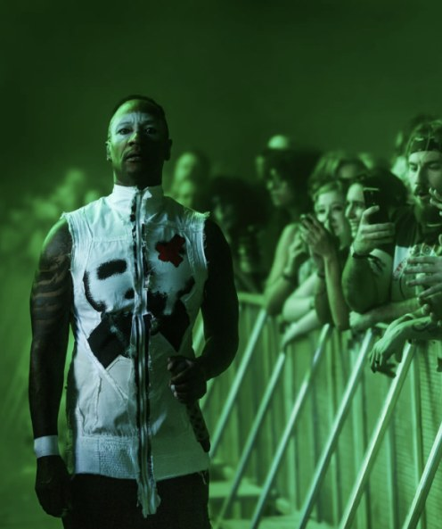

# Bitácora de desarrollo: sitio Creamfields 2027


**Recursos usados:**
- **Figma:** para el diseño.
- **Claude (Anthropic):** una IA conectada al archivo de Figma, para tener mayor exactitud a la hora de preguntarle acerca de los codigos como contraparte para corrección.
- **Material de apoyo entregado en clases**: guia para el HTML y consultar dudas acerca de códigos para el diseño.

---

### ¿Qué hice en el sitio?

- Diseñé en Figma con mi compañera la versión desktop del sitio, su **página de inicio** y la **página de Entradas** y su versión mobile.
- Vi la tipografía y sus estilos, los componentes con sus variantes, noticias e íconos de video, animaciones, distribución, diseño y correcciones de mejoras.
- Corregi los HTML que se habían hecho siguiendo el orden del material de apoyo (ya que habian códigos que no habiamos visto en clases)
- Con apoyo de la IA, pasé el diseño a CSS y luego teniendolo como contraparte corregí el CSS de la página principal hasta donde estaba y lo complete con el resto del diseño que faltaba. El CSS de las entradas solo corregí detalles ya que estaba completo y utilice JavaScript para elementos como el carrusel, botones del video y cuentra regresiva ya que investigando, la IA me dijo que era mejor trabajar esos elementos con JavaScripy para tener un mayor control y que quedaran lo más parecidas al diseño en figma.
- Revisé cada versión en el navegador comparandola con el diseño en figma y fui haciendo las correciones de medidas, proporciones, animaciones, velocidades.
- Después de la clase del día 19 de Octubre corregí los html según un punto en la rúbrica acerca de no usar tanto etiquetas div sino más semánticas.


### ¿Qué dificultades tuve y cómo las resolví?

#### Consulta: necesito descargar el GIF desde el figma pero no se como se hace

> Respecto al fondo de gif del inicio que tengo en mi diseño de figma ¿Cómo lo busco en figma para descargarlo?

**Respuesta de la IA (resumen):** indicó que el fondo es la capa llamada *Degradado*. Explicó que el botón *Export* de Figma baja la imagen sin animación, así que hay que usar el archivo original o un plugin.

**Solución propia (después de buscar en figma ya que no me funcionaba lo que me decia la IA):** el error estaba en que lo intentaba exportar desde la ventana diseño y ahí solo lo convertía en png no me dejaba el gif. Probando descubri que tenía que irme a Dev mode y en recursos salia el gif para poder descargarlo como gif y no como png.

#### Consulta: IA como contraparte

> Tengo un figma, con el diseño completo de una pagina web, incluso con animación. Necesito corregir lo que tengo hecho de HTML y CSS según el diseño que tengo en figma para mostrar la web. Como te lo puedo adjuntar para después yo poder tenerlo como contraparte?

**Respuesta de la IA (resumen):** pidió el enlace del frame principal y explicó dos formas de compartir el archivo: invitar con permiso de lectura o enviar una copia `.fig`, para poder tener más fidelidad con el diseño creado en figma.
**Sugerencias:**
1. **Aceptado:** invitar con permiso de lectura en Figma. Así podia rescatar tal cual las indicaciones.


#### Consulta: Quiero mantener la tipografía Helvetica Neue no otra

> Respecto a la tipografia, necesito mantener Helvetica Neue. Qué se debe hacer pana mantenerla, y que se vea bien en windows.

**Respuesta de la IA (resumen):** explicó que Helvetica Neue no viene en Windows y que tiene licencia. Revise que estuviera instalada en mi PC. La IA convirtió los 5 pesos usados  (Light, Medium, Bold, Heavy y Black) al formato `.woff2` y los adjunte en la carpeta del sitio.

**Antes** (fuente de reemplazo):

```css
 {
  font-family: "Inter Tight";
  font-weight: 500;
 }
```

**Después:**

```css
@font-face {
  font-family: "Helvetica Neue Web";
  font-weight: 500;
  font-display: block;
  src: url("assets/fonts/helvetica-neue-medium.woff2") format("woff2");
}
```

#### Consulta: qué es el hero

> Que son las franjas del hero?

**Respuesta de la IA (resumen):** el *hero* es la primera sección de la página. Las franjas son las 8 bandas horizontales de vidrio desenfocado que cruzan el fondo, y en el Figma son las capas *Frame 1* a *Frame 9*.


### Consulta: HTML
>Por qué a veces se usa span class y otras solo p

**Respuesta de la IA (resumen):** Usar <span> con una clase en lugar de solo <p> depende de qué quieras lograr, ya que son etiquetas con propósitos totalmente distintos en HTML. Es mejor usar <span class="..."> cuando necesitas estilizar o modificar una parte específica dentro de un mismo párrafo o línea sin romper el diseño.
<p> ahí, HTML obligaría a un salto de línea indeseado y rompería la estructura del párrafo. El <span> te deja cambiarle el color, el fondo o la tipografía solo a "muy importante" manteniendo el texto corrido.


#### Consulta: por qué algunas cosas van en JavaScript y no en CSS

> Al investigar como hacer ciertos elementos como el carrusel, cuenta regresiva y controles de un video, según lo que me decian era que había que hacerlos en un .js y no el css, esto por qué es?

**Respuesta de la IA (resumen):**

| Lenguaje | Rol | Ejemplo en el sitio |
|---|---|---|
| **HTML** | **Qué hay** en la página | Un título, una foto, un botón |
| **CSS** | **Cómo se ve** | Colores, tamaños, ubicación, efectos al pasar el mouse |
| **JavaScript** | **Qué hace y cuándo**: calcula, decide y reacciona | Contar el tiempo, mover cosas por pasos, dar órdenes al video |

- **Cuenta regresiva:** hay que saber la hora actual, restarla a la fecha del festival y repetir el cálculo cada segundo. CSS no sabe la hora ni hace cálculos.
- **Controles del video:** el botón tiene que darle una orden al video y cambiar el ícono. Solo JavaScript puede dar órdenes:

```javascript
video.pause();          // pausar
video.muted = false;    // activar el sonido
```

- **Carrusel:** un carrusel simple *sí* se puede hacer solo con CSS (`@keyframes`). Usamos JavaScript para avanzar de a dos fotos con pausas, volver al inicio sin que se note y detenerlo al pasar el mouse.

> ya que no tengo mucho conocimiento para hacer un javascript, me lo podrias generar para esos elementos de mi diseño y hay que poner algo en el html o como se linkea para que el programa lo entienda?

**Respuesta de la IA:** ¡Claro que sí! Con mucho gusto te ayudo a escribir el código JavaScript para que tu diseño tenga interactividad. No te preocupes por no tener conocimientos previos, te lo dejaré listo para copiar y pegar, explicando de forma muy sencilla dónde ponerlo.
Para que tu archivo HTML "entienda" y ejecute el código JavaScript, debes conectarlos. La forma más recomendada y limpia de hacerlo es creando un archivo separado para el JavaScript y vinculándolo al final de tu HTML.
En la misma carpeta donde tienes tu diseño, crea un archivo nuevo y llámalo script.js. Dentro de este archivo pega el siguiente código:

```javascript
/*  Interacciones
   1. Cuenta regresiva 
   2. Carrusel  
   3. Controles del video en la página de Entradas */

/* Cuenta regresiva */
(function cuentaRegresiva() {
  const destino = new Date("2027-08-26T12:00:00+01:00"); 
  const salida = document.getElementById("cuenta");
  if (!salida) return;

  const dos = (n) => String(n).padStart(2, "0");

  function actualizar() {
    let resto = Math.max(0, Math.floor((destino - new Date()) / 1000));
    const dias = Math.floor(resto / 86400); resto %= 86400;
    const horas = Math.floor(resto / 3600); resto %= 3600;
    const minutos = Math.floor(resto / 60);
    const segundos = resto % 60;
   
    salida.textContent = `${String(dias).padStart(3, " ")} : ${dos(horas)}  : ${dos(minutos)}  :  ${dos(segundos)}`;
  }

  actualizar();
  setInterval(actualizar, 1000);
})();

/* Carrusel */
(function carrusel() {
  const pista = document.getElementById("pista");
  if (!pista) return;

  const PASO = 76.625;        // dos fotos con su separación
  const ESPERA = 1500;        // tiempo que se queda quieta cada vista
  const DURACION = 600;       // duración del desplazamiento
  const totalVistas = Math.ceil(pista.children.length / 2);

  // Copia de las dos primeras fotos al final, para que el ciclo sea continuo
  pista.appendChild(pista.children[0].cloneNode(true));
  pista.appendChild(pista.children[1].cloneNode(true));

  let vista = 0;
  let temporizador;

  function mover(animar) {
    pista.style.transition = animar ? `transform ${DURACION}ms cubic-bezier(.65, 0, .35, 1)` : "none";
    pista.style.transform = `translateX(${-vista * PASO}rem)`;
  }

  function siguiente() {
    vista += 1;
    mover(true);
    if (vista === totalVistas) {
      // vuelve al inicio 
      setTimeout(() => { vista = 0; mover(false); }, DURACION + 20);
    }
  }

  function iniciar() { detener(); temporizador = setInterval(siguiente, ESPERA); }
  function detener() { clearInterval(temporizador); }

  // Se pausa mientras el mouse está encima
  pista.parentElement.addEventListener("mouseenter", detener);
  pista.parentElement.addEventListener("mouseleave", iniciar);

  if (!window.matchMedia("(prefers-reduced-motion: reduce)").matches) iniciar();
})();

/* video de la página de Entradas: play/pausa y sonido */
(function controlesVideo() {
  const video = document.getElementById("video-hero");
  const play = document.getElementById("boton-play");
  const sonido = document.getElementById("boton-sonido");
  if (!video || !play || !sonido) return;

  function pintar() {
    const enPausa = video.paused;
    play.querySelector("img").src = enPausa ? "assets/img/icono-play.png" : "assets/img/icono-pausa.png";
    play.setAttribute("aria-label", enPausa ? "Reproducir video" : "Pausar video");
    sonido.querySelector("img").src = video.muted ? "assets/img/icono-silencio.png" : "assets/img/icono-sonido.png";
    sonido.setAttribute("aria-label", video.muted ? "Activar sonido" : "Silenciar");
  }

  play.addEventListener("click", () => { video.paused ? video.play().catch(() => {}) : video.pause(); });
  sonido.addEventListener("click", () => { video.muted = !video.muted; pintar(); });
  video.addEventListener("play", pintar);
  video.addEventListener("pause", pintar);
  pintar();
})();
```
Ahora abre tu archivo HTML y ve hasta el final del documento. Justo antes de la etiqueta de cierre </body>, debes pegar la siguiente línea de código: <script src="script.js"></script>. Esto asegura que el navegador primero cargue todo el diseño visual (los textos, botones y estilos) y, al final, cargue la lógica. Esto hace que tu página web cargue mucho más rápido y evita errores donde JavaScript intenta buscar un botón que el navegador aún no ha dibujado.


#### Consulta: aumentar la velocidad del carrusel

> Necesito aumentar la velocidad de cambio del carrusel, para que quede similar al figma, que se ve que cambia más rapido. Donde debo ajustar eso?

**Respuesta de la IA (resumen):** la velocidad está en `script.js`, no en el CSS, y se mide en milisegundos (1000 = 1 segundo):
- `ESPERA` es el tiempo que se queda quieta cada vista.
- `DURACION` es lo que tarda el deslizamiento.

Para que quede igual al Figma, sugirió copiar el tiempo de la interacción *After delay* del panel **Prototype**.

**Antes:**

```javascript
const ESPERA = 3500;        // tiempo que se queda quieta cada vista
const DURACION = 900;       // duración del desplazamiento
```

**Después:**

```javascript
const ESPERA = [1500];     // tiempo que se queda quieta cada vista
const DURACION = [600];   // duración del desplazamiento
```

**Sugerencias:**
1. **Aceptado:** bajar `ESPERA` y `DURACIÓN` para que cambie más rápido, como en el Figma.
2. **Aceptado:** no modificar `PASO`, porque es el ancho que avanza en cada cambio y las fotos quedarían desalineadas.


#### Consulta: página de Entradas

>puedes darme los códigos en css para la página de entradas en desktop y asi corregir con los que me mandaron, solo usa flexbox, unidades rem y %, estructura con `header`, `main` y `footer` no uses grid*, position ni frameworks.

**Respuesta de la IA (resumen):**
- Creó `entradas.css` con las 27 tarjetas de pases, los 3 servicios extra y los agentes autorizados.
- La conectó con el menú y con el botón del inicio.
- Programó los botones de play/pausa y sonido del video.

**Sugerencias:**
1. **Aceptado:** el ícono de volver al inicio cambia al pasar el mouse, que es la variante del Figma.
2. **Aceptado:** cada tarjeta lleva a la venta de entradas con su link.


#### Consulta: Adaptación del tamaño de pantalla a los distintos dispositivos 
> si tengo una web para computador es mejor poner en los códigos que se adapte a celular o mejor hacer html y css especial para celu?

**Respuesta de la IA (resumen):** Es infinitamente mejor hacer que tu web actual se adapte a celular (diseño responsivo o Responsive Web Design) en lugar de crear una web separada exclusivamente para móviles.
Hoy en día, las páginas web separadas (como las antiguas versiones ://tuweb.com) están en desuso porque los motores de búsqueda como Google penalizan o complican el posicionamiento de los sitios que duplican su contenido.

> Entonces necesito que la página web se adapte al tamaño de la pantalla, para que se vea bien en todos los dispositivos. Que debiese incorporar al html o al CSS?, indicame que debo colocar y donde.

**Respuesta de la IA:** Como todo el sitio está medido en rem, basta achicar el tamaño de letra base *(html)* para que la página completa se reduzca en proporción. En celulares, además, las secciones se ordenan en una sola columna. Todo usa solo rem y % así que sigue cumpliendo.

En el bloque *body*, borra esta línea, que obliga a la página a medir siempre 1280 px:

```css
 min-width: var(--ancho-diseno);
```
Cambia *width: var(--ancho-diseno);* por estas dos líneas:

```css
.contenedor {
  width: 100%;
  max-width: var(--ancho-diseno);
  margin-left: auto;
  margin-right: auto;
}
```
Al final del archivo pega este bloque justo antes del comentario:
* /* Accesibilidad: sin animaciones si  el sistema lo pide */ *

```css
/* =========================================================
   DISEÑO ADAPTABLE (responsive)
   Como todo el sitio está medido en rem, al bajar el tamaño
   de letra base (html) la página completa se achica en
   proporción. En celulares, además, las secciones se ordenan
   en una sola columna.
   ========================================================= */

/* Pantallas medianas: la página se achica por escalones */
@media (max-width: 81rem) { html { font-size: 87.5%; } }   /* menos de 1296 px */
@media (max-width: 71rem) { html { font-size: 75%; } }     /* menos de 1136 px */
@media (max-width: 61rem) {                                 /* menos de 976 px */
  html { font-size: 62.5%; }
  .pie__creditos { font-size: 1rem; line-height: 1.2rem; }
}
@media (max-width: 51rem) { html { font-size: 57%; } }     /* menos de 816 px */

/* Celulares (menos de 768 px) */
@media (max-width: 48rem) {
  html { font-size: 62.5%; }

  .contenedor { padding-left: 1.6rem; padding-right: 1.6rem; }
  .contenido { align-items: stretch; }

  /* Menú: logo arriba y enlaces debajo, centrados */
  .barra-superior { height: auto; padding-bottom: 1.2rem; }
  .barra-superior__contenido { flex-direction: column; align-items: center; }
  .logo { margin: 1.2rem 0 0; }
  .menu { flex-wrap: wrap; justify-content: center; gap: 0.4rem 1.6rem; margin: 0.8rem 0 0; }
  .menu__enlace--lineup,
  .menu__enlace--entradas,
  .menu__enlace--noticias { width: auto; }

  /* Hero en una columna */
  .portada { height: auto; }
  .portada__vidrio { padding-bottom: 4rem; }
  .hero { align-items: center; text-align: center; }
  .hero__titulo { margin: 4rem 0 0; width: 100%; }
  .hero__titulo-imagen { width: 100%; height: auto; }
  .hero__bajada { margin: 2.4rem 0 0; width: 100%; white-space: normal; }
  .hero__bajada br { display: none; }
  .cuenta { margin: 3.2rem 0 0; }
  .hero__fechas { flex-direction: column; align-items: center; gap: 1.6rem; margin: 3.2rem 0 0; }
  .hero__columna--izquierda { width: auto; }
  .boton-entradas { margin: 3.2rem 0 0; }

  /* Carrusel: una foto a la vez, se desliza con el dedo */
  .carrusel { width: 100%; height: auto; margin: 4rem 0 0; overflow: visible; }
  .carrusel__pista {
    transform: none !important;   /* anula el movimiento automático de script.js */
    overflow-x: auto;
    scroll-snap-type: x mandatory;
    gap: 1.6rem;
  }
  .carrusel__foto { width: 100%; height: auto; aspect-ratio: 1; scroll-snap-align: start; }

  /* Títulos de sección */
  .titulo-seccion { max-width: 100%; white-space: normal; }
  .titulo-seccion--lineup,
  .titulo-seccion--noticias,
  .titulo-seccion--app { margin-left: 0; }

  /* Line up: un artista por fila */
  .lineup, .noticias, .app { margin-top: 6rem; }
  .lineup__intro { margin: 3.2rem 0 0; width: 100%; }
  .lineup__artistas { flex-direction: column; gap: 2.4rem; margin: 3.2rem 0 0; width: 100%; }
  .artista { width: 100%; height: auto; aspect-ratio: 496 / 593; }

  /* Noticias: fecha y título uno debajo del otro */
  .noticia {
    flex-direction: column;
    align-items: flex-start;
    justify-content: flex-end;
    width: 100%;
    height: auto;
    aspect-ratio: 1130 / 636;
    margin: 2.4rem 0 0;
    padding: 1.6rem;
  }
  .noticia__fecha { width: auto; margin: 0 0 0.8rem; }
  .noticia__titulo { margin: 0; font-size: 2.2rem; line-height: 2.4rem; white-space: normal; }
  .noticia__titulo br { display: none; }
  .noticia__titulo--1,
  .noticia__titulo--2,
  .noticia__titulo--3 { margin-left: 0; }

  /* Botones de la app a todo el ancho */
  .boton-app { width: 100%; height: auto; margin-left: 0; padding: 1.6rem; font-size: 2rem; line-height: 2.4rem; }
  .boton-app--apple { margin-top: 3.2rem; }
  .boton-app--android { margin-top: 1.6rem; }
  .boton-app__texto--apple,
  .boton-app__texto--android { width: 100%; height: auto; white-space: normal; padding-bottom: 0.8rem; }
  .app__lista { margin: 3.2rem 0 0; width: 100%; }

  /* Partners: los logos se achican para caber */
  .partners { margin-top: 6rem; }
  .partners__fila { max-width: 100%; height: auto; }

  /* Pie de página centrado */
  .pie { height: auto; margin-top: 6rem; padding: 1.6rem 0; }
  .pagina-entradas .pie { margin-top: 6rem; }
  .pie__contenido { flex-direction: column; gap: 1.2rem; height: auto; }
  .pie__marca { align-self: center; align-items: center; margin-left: 0; padding-top: 0; }
  .pie__creditos { margin-left: 0; text-align: center; font-size: 1rem; line-height: 1.2rem; }
  .redes { margin: 0; padding-top: 0; }

  /* Página de Entradas */
  .portada-entradas__video { height: 30rem; }
  .portada-entradas__controles { height: 30rem; margin-top: -30rem; }
  .fila { flex-wrap: wrap; justify-content: center; gap: 2.4rem; margin-left: 0; }
  .agentes { margin-left: 0; }
  .agentes__titulo { white-space: normal; }
}
```

En el celular se ocultan los saltos de línea forzados, y sin un espacio las palabras quedan pegadas (¨Prepáratepara¨). Agrega un espacio antes de cada <br> en estos cuatro lugares:

- El párrafo <p class="hero__bajada">, que tiene 3 <br>
- Los tres títulos <h3 class="noticia__titulo ...>, con 2 <br> cada uno.

```html
<!-- Antes -->
 Prepárate<br>para dos días 
<!-- Después -->
 Prepárate <br>pra dos días
```

>Por lo que estuve investigando, no debería ser simplemente un código al final de CSS?

**Respuesta de la IA:** Sí, tiene razón: se puede dejar todo en un solo bloque al final de *styles.css*, sin tocar nada más. Como es CSS la última regla gana, las dos priemras líneas del bloque reemplazan los cambios que antes te pedía hacer a mano en *body* y *.contenedor*. Abre *styles.css* ve a la última línea y pega esto. No hay que tocar el HTML ni el resto del CSS.

```css
/* =========================================================
   DISEÑO ADAPTABLE (responsive)
   Como todo el sitio está medido en rem, al bajar el tamaño
   de letra base (html) la página completa se achica en
   proporción. En celulares, además, las secciones se ordenan
   en una sola columna.
   ========================================================= */

/* La página deja de medir siempre 1280 px y se ajusta a la pantalla */
body { min-width: 0; }
.contenedor { width: 100%; max-width: var(--ancho-diseno); }

/* Pantallas medianas: la página se achica por escalones */
@media (max-width: 81rem) { html { font-size: 87.5%; } }   /* menos de 1296 px */
@media (max-width: 71rem) { html { font-size: 75%; } }     /* menos de 1136 px */
@media (max-width: 61rem) {                                 /* menos de 976 px */
  html { font-size: 62.5%; }
  .pie__creditos { font-size: 1rem; line-height: 1.2rem; }
}
@media (max-width: 51rem) { html { font-size: 57%; } }     /* menos de 816 px */

/* Celulares (menos de 768 px) */
@media (max-width: 48rem) {
  html { font-size: 62.5%; }

  .contenedor { padding-left: 1.6rem; padding-right: 1.6rem; }
  .contenido { align-items: stretch; }

  /* Menú: logo arriba y enlaces debajo, centrados */
  .barra-superior { height: auto; padding-bottom: 1.2rem; }
  .barra-superior__contenido { flex-direction: column; align-items: center; }
  .logo { margin: 1.2rem 0 0; }
  .menu { flex-wrap: wrap; justify-content: center; gap: 0.4rem 1.6rem; margin: 0.8rem 0 0; }
  .menu__enlace--lineup,
  .menu__enlace--entradas,
  .menu__enlace--noticias { width: auto; }

  /* Hero en una columna */
  .portada { height: auto; }
  .portada__vidrio { padding-bottom: 4rem; }
  .hero { align-items: center; text-align: center; }
  .hero__titulo { margin: 4rem 0 0; width: 100%; }
  .hero__titulo-imagen { width: 100%; height: auto; }
  .hero__bajada { margin: 2.4rem 0 0; width: 100%; white-space: normal; }
  .cuenta { margin: 3.2rem 0 0; }
  .hero__fechas { flex-direction: column; align-items: center; gap: 1.6rem; margin: 3.2rem 0 0; }
  .hero__columna--izquierda { width: auto; }
  .boton-entradas { margin: 3.2rem 0 0; }

  /* Carrusel: una foto a la vez, se desliza con el dedo */
  .carrusel { width: 100%; height: auto; margin: 4rem 0 0; overflow: visible; }
  .carrusel__pista {
    transform: none !important;   /* anula el movimiento automático de script.js */
    overflow-x: auto;
    scroll-snap-type: x mandatory;
    gap: 1.6rem;
  }
  .carrusel__foto { width: 100%; height: auto; aspect-ratio: 1; scroll-snap-align: start; }

  /* Títulos de sección */
  .titulo-seccion { max-width: 100%; white-space: normal; }
  .titulo-seccion--lineup,
  .titulo-seccion--noticias,
  .titulo-seccion--app { margin-left: 0; }

  /* Line up: un artista por fila */
  .lineup, .noticias, .app { margin-top: 6rem; }
  .lineup__intro { margin: 3.2rem 0 0; width: 100%; }
  .lineup__artistas { flex-direction: column; gap: 2.4rem; margin: 3.2rem 0 0; width: 100%; }
  .artista { width: 100%; height: auto; aspect-ratio: 496 / 593; }

  /* Noticias: fecha y título uno debajo del otro */
  .noticia {
    flex-direction: column;
    align-items: flex-start;
    justify-content: flex-end;
    width: 100%;
    height: auto;
    aspect-ratio: 1130 / 636;
    margin: 2.4rem 0 0;
    padding: 1.6rem;
  }
  .noticia__fecha { width: auto; margin: 0 0 0.8rem; }
  .noticia__titulo { margin: 0; font-size: 2.2rem; line-height: 2.4rem; white-space: normal; }
  .noticia__titulo--1,
  .noticia__titulo--2,
  .noticia__titulo--3 { margin-left: 0; }

  /* Botones de la app a todo el ancho */
  .boton-app { width: 100%; height: auto; margin-left: 0; padding: 1.6rem; font-size: 2rem; line-height: 2.4rem; }
  .boton-app--apple { margin-top: 3.2rem; }
  .boton-app--android { margin-top: 1.6rem; }
  .boton-app__texto--apple,
  .boton-app__texto--android { width: 100%; height: auto; white-space: normal; padding-bottom: 0.8rem; }
  .app__lista { margin: 3.2rem 0 0; width: 100%; }

  /* Partners: los logos se achican para caber */
  .partners { margin-top: 6rem; }
  .partners__fila { max-width: 100%; height: auto; }

  /* Pie de página centrado */
  .pie { height: auto; margin-top: 6rem; padding: 1.6rem 0; }
  .pagina-entradas .pie { margin-top: 6rem; }
  .pie__contenido { flex-direction: column; gap: 1.2rem; height: auto; }
  .pie__marca { align-self: center; align-items: center; margin-left: 0; padding-top: 0; }
  .pie__creditos { margin-left: 0; text-align: center; font-size: 1rem; line-height: 1.2rem; }
  .redes { margin: 0; padding-top: 0; }

  /* Página de Entradas */
  .portada-entradas__video { height: 30rem; }
  .portada-entradas__controles { height: 30rem; margin-top: -30rem; }
  .fila { flex-wrap: wrap; justify-content: center; gap: 2.4rem; margin-left: 0; }
  .agentes { margin-left: 0; }
  .agentes__titulo { white-space: normal; }
}
```
#### Consulta: revisar los códigos con la rúbrica

>Quiero que revises los códigos del sitio, y que lo compares con los puntos de la imagen de la rúbrica que te adjunte, para que determines que debo corregir para cumplir con ella. Indicame que es lo que esta bien, y que es lo que debo corregir. Además el HTML de mi sitio debe ser semántico, para la corrección basate en la imagen "HTML semántico" que es la que me enseñaron en clases.

**Respuesta de la IA:** hoy ya cumples el mínimo del nivel alto (header, main, footer y al menos dos section en ambas páginas). Como pediste usar todas las etiquetas semánticas que correspondan, lo que sigue son mejoras para acercarte al modelo de Semrush, Lo que está bien:
-	Ambas páginas tienen header, main y footer.
-	index.html tiene 5 section: carrusel, line up, noticias, app y partners.
-	entradas.html tiene 2 section: pases y agentes.
-	El menú usa nav con aria-label.
-	Las noticias usan article con time datetime.
-	La jerarquía de títulos es correcta: un h1 por página, luego h2 y h3.
-	Los agentes de venta están en una lista ul/li.
-	Las dos páginas cargan lang="es".

**Qué corregir en index.html**
1.	El hero está dentro del header. El título, la bajada, la cuenta regresiva, las fechas y el botón son el contenido principal de la página, no el encabezado del sitio. Lo recomendable es dejar en el header solo el logo y el nav, y mover el hero al main como su propia section. Es el cambio más importante, porque coincide exactamente con el esquema de Semrush (header → nav → main).
2.	Las fechas del evento son párrafos sueltos. "Jueves 26 * Domingo 29 de agosto 2027" debería usar <time datetime="2027-08-26">, igual que ya lo haces en noticias.
3.	Las fotos del line up y de las noticias son fondos CSS (background-image). Para la semántica, una imagen que es contenido debería ir en el HTML. 
o	Line up: cada artista como <figure> con  y <figcaption> para el nombre. El conjunto de artistas como lista ul/li.
o	Noticias: la foto como <figure>/ dentro del article, y la fecha más el título dentro de un <header> del artículo. Así queda igual al bloque article → header → figure del modelo Semrush.
4.	Carrusel: las fotos pueden ir en <figure>.
5.	Partners es un buen candidato para <aside>. Patrocinadores y media partners son contenido complementario, no central. Es el uso legítimo de aside en el sitio, sin forzarlo.
6.	Redes sociales en el footer. Hoy son un div con enlaces. Lo correcto es un <nav aria-label="Redes sociales"> con una lista ul/li.

**Antes:**
```html
<header class="portada">
  <div class="portada__vidrio">
    <div class="barra-superior">
      <div class="contenedor barra-superior__contenido">
        <a href="index.html" class="logo">…</a>
        <nav class="menu" aria-label="Principal">…</nav>
      </div>
    </div>
    <div class="contenedor hero">
      <h1 class="hero__titulo">…</h1>
      … bajada, cuenta regresiva, fechas, botón …
    </div>
  </div>
</header>

<main class="contenedor contenido">
  <section class="carrusel">…</section>
  …
</main>
```

**Después:**
```html
<header class="barra-superior">
  <div class="contenedor barra-superior__contenido">
    <a href="index.html" class="logo">…</a>
    <nav class="menu" aria-label="Principal">…</nav>
  </div>
</header>

<main>
  <section class="portada">
    <div class="portada__vidrio">
      <div class="contenedor hero">
        <h1 class="hero__titulo">…</h1>
        … bajada, cuenta regresiva, fechas, botón …
      </div>
    </div>
  </section>

  <div class="contenedor contenido">
    <section class="carrusel">…</section>
    …
  </div>
</main>
```

**Antes:**
```css
.portada {
  height: 58.8125rem;
  …
}
.portada__vidrio {
  height: 100%;
  …
}
.barra-superior {
  height: 5.125rem;
  …
}

/* celulares */
.portada { height: auto; }
.portada__vidrio { padding-bottom: 4rem; }
```

**Después:**
```css
/* la portada empieza bajo el encabezado: su alto descuenta el del encabezado (58.8125 - 5.125) */
.portada {
  height: 53.6875rem;
  …
}
.portada__vidrio {
  height: 100%;
  …
}
.barra-superior {
  height: 5.125rem;
  …
}

/* celulares (sin cambios) */
.portada { height: auto; }
.portada__vidrio { padding-bottom: 4rem; }
```

**Antes**
```html
<p class="hero__dato">Jueves 26 * Domingo 29 de agosto</p>
<p class="hero__dato">2027</p>
```

**Después:**
```html
<p class="hero__dato"><time datetime="2027-08-26">Jueves 26</time> * <time datetime="2027-08-29">Domingo 29 de agosto</time></p>
<p class="hero__dato"><time datetime="2027">2027</time></p>
```

**Antes**
```html
<section class="carrusel" aria-label="Fotos del festival">
  <div class="carrusel__pista" id="pista">
    
    … (10 fotos)
  </div>
</section>
```

**Después:**
```html
<section class="carrusel">
  <h2 class="solo-lectores">Fotos del festival</h2>
  <div class="carrusel__pista" id="pista">
    <figure class="carrusel__item"></figure>
    … (10 fotos)
  </div>
</section>
```

**Antes:**
```css
.carrusel__foto {
  flex: none;
  width: 35rem;
  height: 35rem;
  object-fit: cover;
}

/* celulares */
.carrusel__foto { width: 100%; height: auto; aspect-ratio: 1; scroll-snap-align: start; }
```

**Después:**
```css
.carrusel__item {
  flex: none;
  width: 35rem;
  height: 35rem;
}

.carrusel__foto {
  width: 100%;
  height: 100%;
  object-fit: cover;
}

/* celulares */
.carrusel__item { width: 100%; height: auto; aspect-ratio: 1; scroll-snap-align: start; }
```

**Antes**
```html
<div class="lineup__artistas">
  <a class="artista artista--prodigio" href="https://www.instagram.com/theprodigyofficial/" target="_blank" rel="noopener">
    <span class="artista__nombre">El Prodigio</span>
  </a>
  … (5 artistas)
</div>
```
**Después:**
```html
<ul class="lineup__artistas">
  <li class="artista">
    <a class="artista__enlace" href="https://www.instagram.com/theprodigyofficial/" target="_blank" rel="noopener">
      <figure class="artista__figura">
        
        <figcaption class="artista__nombre">El Prodigio</figcaption>
      </figure>
    </a>
  </li>
  … (5 artistas)
</ul>
```

**Antes:**
```css
.lineup__artistas {
  …
  width: 65.4375rem;
}

.artista {
  display: flex;
  justify-content: center;
  width: 31rem;
  height: 37.0625rem;
  padding-top: 1.4375rem;
  background-position: center;
  background-size: 100% 100%;
  background-repeat: no-repeat;
}

.artista--prodigio { background-image: url("assets/img/lineup-el-prodigio.jpg"); }
.artista--rizardo  { background-image: url("assets/img/lineup-franky-rizardo.jpg"); }
.artista--carola   { background-image: url("assets/img/lineup-marco-carola.jpg"); }
.artista--laing    { background-image: url("assets/img/lineup-hannah-laing.jpg"); }
.artista--jones    { background-image: url("assets/img/lineup-jamie-jones.jpg"); }

.artista__nombre {
  font-weight: 700;
  …
}

/* celulares */
.artista { width: 100%; height: auto; aspect-ratio: 496 / 593; }
```

**Después:**
```css
.lineup__artistas {
  …
  width: 65.4375rem;
  list-style: none;
}

.artista__enlace { display: block; }

.artista__figura {
  width: 31rem;
  height: 37.0625rem;
}

.artista__foto {
  width: 100%;
  height: 100%;
}

/* el nombre sube sobre la foto: margen negativo igual al alto de la foto
   (119.5565% del ancho = proporción 593 / 496) */
.artista__nombre {
  margin-top: -119.5565%;
  padding-top: 1.4375rem;
  text-align: center;
  font-weight: 700;
  …
}

/* celulares */
.artista { width: 100%; }
.artista__figura { width: 100%; height: auto; aspect-ratio: 496 / 593; }
.artista__foto { height: auto; aspect-ratio: 496 / 593; }
```

**Antes**
```html
<article class="noticia noticia--1">
  <time class="noticia__fecha" datetime="2026-10-02">02 / 10 / 2026</time>
  <h3 class="noticia__titulo noticia__titulo--1">Todas las plazas para acampar<br>…</h3>
</article>
```

**Después:**
```html
<article class="noticia noticia--1">
  <figure class="noticia__figura">
    
  </figure>
  <header class="noticia__encabezado">
    <time class="noticia__fecha" datetime="2026-10-02">02 / 10 / 2026</time>
    <h3 class="noticia__titulo noticia__titulo--1">Todas las plazas para acampar<br>…</h3>
  </header>
</article>
```

**Antes:**
```css
.noticia {
  display: flex;
  align-items: flex-end;
  …
  padding-bottom: 1.875rem;
  background-position: center;
  background-size: 100% 100%;
  background-repeat: no-repeat;
  transition: background-size .5s cubic-bezier(.22, 1, .36, 1);
}
.noticia:hover { background-size: 104.8% 104.8%; }

.noticia--1 { margin-top: 3rem; background-image: url("assets/img/noticia-1.jpg"); }
.noticia--2 { background-image: url("assets/img/noticia-2.jpg"); }
.noticia--3 { background-image: url("assets/img/noticia-3.jpg"); }
```

**Después:**
```css
.noticia {
  display: flex;
  align-items: flex-end;
  …
  overflow: hidden;
}

.noticia--1 { margin-top: 3rem; }

/* foto de la noticia: ocupa toda la tarjeta y centra la imagen */
.noticia__figura {
  flex: none;
  align-self: stretch;
  display: flex;
  justify-content: center;
  align-items: center;
  width: 100%;
}

/* fecha y título: retroceden el 100% del ancho para quedar sobre la foto */
.noticia__encabezado {
  flex: none;
  display: flex;
  align-items: flex-end;
  margin-left: -100%;
  padding-bottom: 1.875rem;
}

/* al pasar el mouse la foto crece desde el centro */
.noticia__foto {
  flex: none;
  width: 100%;
  height: 100%;
  transition: width .5s cubic-bezier(.22, 1, .36, 1), height .5s cubic-bezier(.22, 1, .36, 1);
}
.noticia:hover .noticia__foto { width: 104.8%; height: 104.8%; }

/* celulares */
.noticia {
  width: 100%;
  height: auto;
  aspect-ratio: 1130 / 636;
  margin: 2.4rem 0 0;
}
.noticia__encabezado { flex-direction: column; align-items: flex-start; width: 100%; padding: 1.6rem; }
```


**Antes**
```html
    <section class="partners" aria-label="Partners">
      <h2 class="partners__titulo">Partners</h2>
      … logos …
    </section>

  </main>
```

**Después:**
```html
 </main>

  <aside class="contenedor partners">
    <h2 class="partners__titulo">Partners</h2>
    … logos …
  </aside>
```

**Antes**
```html
<div class="redes">
  <a class="red" href="https://www.facebook.com/OfficialCreamfields" target="_blank" rel="noopener" aria-label="Facebook">
    </a>
  <a class="red red--instagram" … aria-label="Instagram">…</a>
  <a class="red red--youtube" … aria-label="YouTube">…</a>
  <a class="red red--tiktok" … aria-label="TikTok">…</a>
</div>
```

**Después:**
```html
<nav class="redes" aria-label="Redes sociales">
  <ul class="redes__lista">
    <li class="red">
      <a class="red__enlace" href="https://www.facebook.com/OfficialCreamfields" target="_blank" rel="noopener" aria-label="Facebook">
        </a>
    </li>
    <li class="red red--instagram">…</li>
    <li class="red red--youtube">…</li>
    <li class="red red--tiktok">…</li>
  </ul>
</nav>
```

**Antes:**
```css
.redes {
  display: flex;
  align-items: center;
  margin-left: auto;
  margin-right: 2.375rem;
  padding-top: 0.125rem;
}
```

**Después:**
```css
.redes {
  margin-left: auto;
  margin-right: 2.375rem;
  padding-top: 0.125rem;
}

.redes__lista {
  display: flex;
  align-items: center;
  list-style: none;
}

.red__enlace { display: block; }
```


**entradas**
Estilos CSS, Lo que está bien:
-	Hoja externa: styles.css está enlazada en ambas páginas.
-	Selectores de clase: usas convención BEM de forma consistente. No hay estilos por id, que solo se usan para el JavaScript. Los selectores por etiqueta (*, html, body, img, a) son solo el reseteo base, lo cual es correcto.
-	Flexbox: se usa ampliamente en barra, hero, secciones, line up, pases, pie y redes. Supera de sobra el mínimo de "al menos una sección".
-	Tipografía coherente con Figma: todos los estilos calzan exacto con los estilos de texto del Figma. 
-	Helvetica Neue en pesos 300, 500, 700, 800 y 900.
-	Tamaños 10/12, 20/20, 20/33, 24/28, 32/33, 36/33 y 48/48.
-	Colores coherentes con Figma: #fbf188, #6c0798, #3f016a, #e4ccff (hover) y #582a76 (botones de la app) coinciden con el kit y los componentes.

**Qué corregir en entradas.html**
1.	El header no tiene navegación. El enlace "volver al inicio" debería ir dentro de un <nav>. El Figma de Entradas tampoco tiene menú, así que no hace falta agregarlo.
2.	El video es contenido. Puede ir en un <figure> dentro del header, o pasar al main.
3.	La sección de pases no tiene título. Hoy solo tiene aria-label, y toda section debería tener un encabezado. Basta con un h2 oculto con tu clase solo-lectores.
4.	Las 9 filas son div sin significado. Cada fila corresponde a una categoría (Estándar con camping, Bronce, Plata, Oro, sin camping, por día). Lo semántico es que cada fila sea una lista ul/li, o una section con su propio título oculto.
5.	Cada tarjeta es puro span. El nombre del pase ("Dos Días", "Tres Días") debería ser un título h3, y el resto párrafos.
6.	Los extras son otro tipo de contenido. Gran entrenador verde, autobús y aparcamiento no son entradas, sino servicios. Corresponde una section propia con su título, por ejemplo "Servicios adicionales".


**Antes**
```html
<header class="portada-entradas">
  <video class="portada-entradas__video" id="video-hero" autoplay muted loop playsinline poster="assets/img/entradas-hero.jpg">
    <source src="assets/video/entradas-hero.mp4" type="video/mp4">
  </video>
  <div class="contenedor portada-entradas__controles">
    <a class="volver" href="index.html" aria-label="Volver al inicio"></a>
    <div class="portada-entradas__botones">…</div>
  </div>
</header>
```

**Después:**
```html
<header class="portada-entradas">
  <figure class="portada-entradas__figura">
    <video class="portada-entradas__video" id="video-hero" autoplay muted loop playsinline poster="assets/img/entradas-hero.jpg">
      <source src="assets/video/entradas-hero.mp4" type="video/mp4">
    </video>
  </figure>
  <div class="contenedor portada-entradas__controles">
    <nav class="portada-entradas__nav" aria-label="Principal">
      <a class="volver" href="index.html" aria-label="Volver al inicio"></a>
    </nav>
    <div class="portada-entradas__botones">…</div>
  </div>
</header>
```

**Antes:**
```css
.volver {
  width: 3.75rem;
  …
}
```

**Después:**
```css
.volver {
  display: block;
  width: 3.75rem;
  …
}
```

**Antes**
```html
<section class="pases" aria-label="Entradas disponibles">
  <div class="fila fila--1">
    <a class="pase" href="https://www.ticketmaster.co.uk/creamfields-2027-tickets/artist/29232" target="_blank" rel="noopener">
      <span class="pase__nivel">Estándar</span>
      <span class="pase__titulo">Dos Días</span>
      <span class="pase__detalle">Sábado + Domingo<br>Camping</span>
      <span class="pase__precio">$356.596 CLP</span>
    </a>
    … (3 tarjetas por fila)
  </div>
  … (8 filas)
</section>
```

**Después:**
```html
<section class="pases" aria-labelledby="titulo-pases">
  <h2 class="solo-lectores" id="titulo-pases">Entradas disponibles</h2>
  <ul class="fila fila--1" aria-label="Pases Estándar con camping">
    <li>
      <a class="pase" href="https://www.ticketmaster.co.uk/creamfields-2027-tickets/artist/29232" target="_blank" rel="noopener">
        <p class="pase__nivel">Estándar</p>
        <h3 class="pase__titulo">Dos Días</h3>
        <p class="pase__detalle">Sábado + Domingo<br>Camping</p>
        <p class="pase__precio">$356.596 CLP</p>
      </a>
    </li>
    … (3 tarjetas por fila)
  </ul>
  … (8 filas)
</section>
```

**Antes:**
```css
.fila {
  display: flex;
  gap: 4.625rem;
  margin-left: 7.8125rem;
}
```

**Después:**
```css
.fila {
  display: flex;
  gap: 4.625rem;
  margin-left: 7.8125rem;
  list-style: none;
}
```

**Antes**
```html
  <div class="fila fila--extras">
    <a class="pase pase--extra" href="https://www.biggreencoach.co.uk/events/creamfields-festival-ticket-and-coach-travel/" target="_blank" rel="noopener">
      <span class="pase__titulo pase__titulo--extra">Gran<br>entrenador<br>verde</span>
      <span class="pase__detalle pase__detalle--extra">Paquetes de viaje neutros en carbono</span>
    </a>
    … (3 tarjetas)
  </div>
</section>  <!-- cierre de la sección de pases -->
```

**Después:**
```html
</section>  <!-- cierre de la sección de pases -->

<section class="servicios" aria-labelledby="titulo-servicios">
  <h2 class="solo-lectores" id="titulo-servicios">Servicios adicionales</h2>
  <ul class="fila fila--extras">
    <li>
      <a class="pase pase--extra" href="https://www.biggreencoach.co.uk/events/creamfields-festival-ticket-and-coach-travel/" target="_blank" rel="noopener">
        <h3 class="pase__titulo pase__titulo--extra">Gran<br>entrenador<br>verde</h3>
        <p class="pase__detalle pase__detalle--extra">Paquetes de viaje neutros en carbono</p>
      </a>
    </li>
    … (3 tarjetas)
  </ul>
</section>
``` 

**Ajustes generales en CSS**

**Antes:**
```css
body {
  min-width: var(--ancho-diseno);
  font-family: var(--fuente);
  …
}

.contenedor {
  width: var(--ancho-diseno);
  margin-left: auto;
  margin-right: auto;
}

…

/* diseño adaptable */

body { min-width: 0; }
.contenedor { width: 100%; max-width: var(--ancho-diseno); }
``` 

**Después:**
```css
body {
  font-family: var(--fuente);
  …
}

.contenedor {
  width: 100%;
  max-width: var(--ancho-diseno);
  margin-left: auto;
  margin-right: auto;
}

…

/* diseño adaptable */
``` 

**Antes:**
```css
.solo-lectores {
  width: 0.0625rem;
  height: 0.0625rem;
  …
}
``` 

**Después:**
```css
.solo-lectores {
  width: 0.0625rem;
  height: 0.0625rem;
  margin: 0 0 -0.0625rem;
  …
}
``` 

**Antes:**
```css
body {
  min-width: var(--ancho-diseno);
  font-family: var(--fuente);
  color: var(--blanco);
  -webkit-font-smoothing: antialiased;
}

.contenedor {
  width: var(--ancho-diseno);
  margin-left: auto;
  margin-right: auto;
}

/* al final del archivo, en "diseño adaptable" */
body {
  min-width: 0;
}

.contenedor {
  width: 100%;
  max-width: var(--ancho-diseno);
}
``` 

**Después:**
```css
body {
  font-family: var(--fuente);
  color: var(--blanco);
  -webkit-font-smoothing: antialiased;
}

.contenedor {
  width: 100%;
  max-width: var(--ancho-diseno);
  margin-left: auto;
  margin-right: auto;
}
``` 

**Antes:**
```css
.solo-lectores {
  width: 0.0625rem;
  height: 0.0625rem;
  margin: -0.0625rem;
  overflow: hidden;
  clip-path: inset(50%);
  white-space: nowrap;
}
``` 

**Después:**
```css
.solo-lectores {
  width: 0.0625rem;
  height: 0.0625rem;
  margin: 0 0 -0.0625rem;
  overflow: hidden;
  clip-path: inset(50%);
  white-space: nowrap;
}
```

**Antes:**
```css  
.portada {
  height: 58.8125rem;
  background-image:
    url("assets/img/fondo-hero.gif"),
    url("assets/img/fondo-degradado.jpg");
  background-size: cover, cover;
  background-position: center, center;
  background-repeat: no-repeat, no-repeat;
}
```

**Después:**
```css  
.portada {
  height: 53.6875rem;
  background-image:
    url("assets/img/fondo-hero.gif"),
    url("assets/img/fondo-degradado.jpg");
  background-size: cover, cover;
  background-position: center, center;
  background-repeat: no-repeat, no-repeat;
}
```

**Antes:**
```css 
.carrusel__foto {
  flex: none;
  width: 35rem;
  height: 35rem;
  object-fit: cover;
}

/* .carrusel__item: no existía */

/* celulares */
@media (max-width: 48rem) {
  .carrusel__foto {
    width: 100%;
    height: auto;
    aspect-ratio: 1;
    scroll-snap-align: start;
  }

  /* .carrusel__item: no existía */
}
```

**Después:**
```css  
.carrusel__foto {
  width: 100%;
  height: 100%;
  object-fit: cover;
}

.carrusel__item {
  flex: none;
  width: 35rem;
  height: 35rem;
}

/* celulares */
@media (max-width: 48rem) {
  /* .carrusel__foto: eliminada */

  .carrusel__item {
    width: 100%;
    height: auto;
    aspect-ratio: 1;
    scroll-snap-align: start;
  }
}
```

**Antes:**
```css 
.lineup__artistas {
  display: flex;
  flex-wrap: wrap;
  gap: 4.6875rem 3.4375rem;
  margin-top: 6.3125rem;
  margin-left: 7.4375rem;
  width: 65.4375rem;
}

.artista {
  display: flex;
  justify-content: center;
  width: 31rem;
  height: 37.0625rem;
  padding-top: 1.4375rem;
  background-position: center;
  background-size: 100% 100%;
  background-repeat: no-repeat;
}

.artista--prodigio {
  background-image: url("assets/img/lineup-el-prodigio.jpg");
}

.artista--rizardo {
  background-image: url("assets/img/lineup-franky-rizardo.jpg");
}

.artista--carola {
  background-image: url("assets/img/lineup-marco-carola.jpg");
}

.artista--laing {
  background-image: url("assets/img/lineup-hannah-laing.jpg");
}

.artista--jones {
  background-image: url("assets/img/lineup-jamie-jones.jpg");
}

/* .artista__enlace: no existía */

/* .artista__figura: no existía */

/* .artista__foto: no existía */

.artista__nombre {
  font-weight: 700;
  font-size: 2rem;
  line-height: 2.0625rem;
  opacity: .6;
}

/* celulares */
@media (max-width: 48rem) {
  .artista {
    width: 100%;
    height: auto;
    aspect-ratio: 496 / 593;
  }

  /* .artista__figura: no existía */

  /* .artista__foto: no existía */
}
```

**Después:**
```css  
.lineup__artistas {
  display: flex;
  flex-wrap: wrap;
  gap: 4.6875rem 3.4375rem;
  margin-top: 6.3125rem;
  margin-left: 7.4375rem;
  width: 65.4375rem;
  list-style: none;
}

/* .artista: se elimina */

/* .artista--prodigio: se elimina */

/* .artista--rizardo: se elimina */

/* .artista--carola: se elimina */

/* .artista--laing: se elimina */

/* .artista--jones: se elimina */

.artista__enlace {
  display: block;
}

.artista__figura {
  width: 31rem;
  height: 37.0625rem;
}

.artista__foto {
  width: 100%;
  height: 100%;
}

.artista__nombre {
  margin-top: -119.5565%;
  padding-top: 1.4375rem;
  text-align: center;
  font-weight: 700;
  font-size: 2rem;
  line-height: 2.0625rem;
  opacity: .6;
}

/* celulares */
@media (max-width: 48rem) {
  .artista {
    width: 100%;
  }

  .artista__figura {
    width: 100%;
    height: auto;
    aspect-ratio: 496 / 593;
  }

  .artista__foto {
    height: auto;
    aspect-ratio: 496 / 593;
  }
}
```

**Antes:**
```css 
.noticia {
  display: flex;
  align-items: flex-end;
  width: 70.625rem;
  height: 39.75rem;
  margin-top: 4rem;
  margin-left: 4.6875rem;
  padding-bottom: 1.875rem;
  background-position: center;
  background-size: 100% 100%;
  background-repeat: no-repeat;
  transition: background-size .5s cubic-bezier(.22, 1, .36, 1);
}

.noticia:hover {
  background-size: 104.8% 104.8%;
}

.noticia--1 {
  margin-top: 3rem;
  background-image: url("assets/img/noticia-1.jpg");
}

.noticia--2 {
  background-image: url("assets/img/noticia-2.jpg");
}

.noticia--3 {
  background-image: url("assets/img/noticia-3.jpg");
}

/* .noticia__figura: no existía */

/* .noticia__encabezado: no existía */

/* .noticia__foto: no existía */

/* .noticia:hover .noticia__foto: no existía */

/* celulares */
@media (max-width: 48rem) {
  .noticia {
    flex-direction: column;
    align-items: flex-start;
    justify-content: flex-end;
    width: 100%;
    height: auto;
    aspect-ratio: 1130 / 636;
    margin: 2.4rem 0 0;
    padding: 1.6rem;
  }

  /* .noticia__encabezado: no existía */
}
```

**Después:**
```css 
.noticia {
  display: flex;
  align-items: flex-end;
  width: 70.625rem;
  height: 39.75rem;
  margin-top: 4rem;
  margin-left: 4.6875rem;
  overflow: hidden;
}

/* .noticia:hover: se elimina */

.noticia--1 {
  margin-top: 3rem;
}

/* .noticia--2: se elimina */

/* .noticia--3: se elimina */

.noticia__figura {
  flex: none;
  align-self: stretch;
  display: flex;
  justify-content: center;
  align-items: center;
  width: 100%;
}

.noticia__encabezado {
  flex: none;
  display: flex;
  align-items: flex-end;
  margin-left: -100%;
  padding-bottom: 1.875rem;
}

.noticia__foto {
  flex: none;
  width: 100%;
  height: 100%;
  transition: width .5s cubic-bezier(.22, 1, .36, 1), height .5s cubic-bezier(.22, 1, .36, 1);
}

.noticia:hover .noticia__foto {
  width: 104.8%;
  height: 104.8%;
}

/* celulares */
@media (max-width: 48rem) {
  .noticia {
    width: 100%;
    height: auto;
    aspect-ratio: 1130 / 636;
    margin: 2.4rem 0 0;
  }

  .noticia__encabezado {
    flex-direction: column;
    align-items: flex-start;
    width: 100%;
    padding: 1.6rem;
  }
}
```

**Antes:**
```css 
.redes {
  display: flex;
  align-items: center;
  margin-left: auto;
  margin-right: 2.375rem;
  padding-top: 0.125rem;
}

/* .redes__lista: no existía */

/* .red__enlace: no existía */
```

**Después:**
```css 
.redes {
  margin-left: auto;
  margin-right: 2.375rem;
  padding-top: 0.125rem;
}

.redes__lista {
  display: flex;
  align-items: center;
  list-style: none;
}

.red__enlace {
  display: block;
}
```

**Antes:**
```css 
.portada-entradas__controles {
  display: flex;
  flex-direction: column;
  justify-content: space-between;
  height: 52.625rem;
  margin-top: -52.625rem;
  z-index: 1;
}

.volver {
  width: 3.75rem;
  height: 3.1875rem;
  margin-left: 1.8125rem;
  margin-top: 1.3125rem;
  background: url("assets/img/icono-volver.png") center / 3rem 2.5625rem no-repeat;
  transition: background-size .25s ease;
}

.fila {
  display: flex;
  gap: 4.625rem;
  margin-left: 7.8125rem;
}
```

**Después:**
```css 
.portada-entradas__controles {
  display: flex;
  flex-direction: column;
  justify-content: space-between;
  height: 52.625rem;
  margin-top: -52.625rem;
}

.volver {
  display: block;
  width: 3.75rem;
  height: 3.1875rem;
  margin-left: 1.8125rem;
  margin-top: 1.3125rem;
  background: url("assets/img/icono-volver.png") center / 3rem 2.5625rem no-repeat;
  transition: background-size .25s ease;
}

.fila {
  display: flex;
  gap: 4.625rem;
  margin-left: 7.8125rem;
  list-style: none;
}
```

Estructura final de index.html: header (logo + nav) → main (section portada, section carrusel, section line up, section noticias con 3 article, section app) → aside (partners) → footer (nav de redes).
Estructura final de entradas.html: header (figure con video + nav) → main (h1, section pases, section servicios, section agentes) → footer (nav de redes).

### ¿Qué aprendí?

- **Un diseño ordenado facilita el desarrollo:** desde el Figma había que seguir el mismo paso a paso que se hizo para realizar el diseño así quedaba en codigos ordenado y también ponerle estos comentarios arriba de los códigos para que después sea más fácil saber a que corresponde cada código al momento de tener que editar algo.
- **Las fuentes puede que no se vean igual en todos los computadores:** una fuente instalada en mi computador no se ve igual en otro computador si no se incluye en el sitio.
- **El orden importa:** un archivo mal nombrado o un código mal escrito basta para que algo no funcione, es por eso que hay que mantener un orden y colocarle comentarios o notas antes indicando qué es o que hace para que así sea más fácil a la hora de cambiar algun código.
- **Cómo funciona `:hover`:** los efectos al pasar el mouse se escriben con `:hover` y se suavizan con `transition`. Para quitar un efecto basta borrar esas reglas.
- **Un solo CSS para varias páginas:** si dos páginas usan el mismo `styles.css`, un cambio se aplica en ambas por lo cual es mejor hacer un solo CSS y así no repetir códigos innecesarios.
- **HTML, CSS y JavaScript tienen roles distintos:** HTML define *qué hay*, CSS define *cómo se ve* y JavaScript define *qué hace y cuándo*. Si algo solo cambia de aspecto va en CSS; si hay que calcular, recordar o dar órdenes, va en JavaScript.
- **Uso de la IA con críterio:** Utilizarla como una herramienta de apoyo para comprender y corregir el código, pero también a contrastar sus respuestas con el material de clases, realizar pruebas y buscar soluciones por mi cuenta cuando las indicaciones no funcionaban.
- **Estructura semántica en HTML:** Aprendí la importancia de utilizar etiquetas HTML según la función del contenido, como header, main, section, article y footer, para organizar mejor la información y construir una estructura más clara y coherente.
- **Diseño responsivo:** Aprendí que una página web debe adaptarse a diferentes tamaños de pantalla, reorganizando sus elementos para mantener una buena visualización y facilitar la navegación tanto en computadores como en celular.
- **Diseño y experiencia de usuario:** Una web no solo debe verse como el diseño original, sino que también debe ser funcional, comprensible y fácil de navegar. Los botones, enlaces, animaciones y la adaptación a distintos dispositivos forman parte de la experiencia de usuario.
- **Resolución de problemas y autonomía:** Los errores y las dificultades son parte del proceso. Investigar y probar distintas soluciones me permitió comprender mejor los problemas y encontrar soluciones que no siempre aparecían a la primera. Si bien aún me queda mucho por aprender ya no me siento tan perdida como la primera vez que vi los códigos y también que esto requiere de paciencia.
