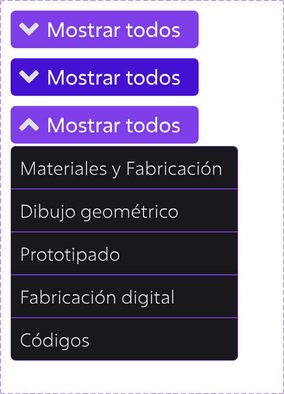
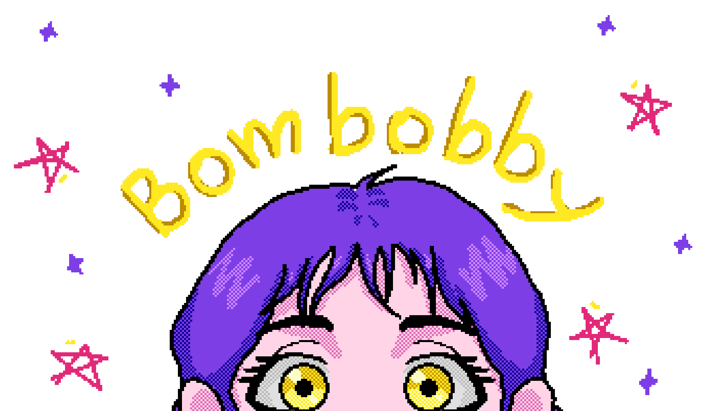
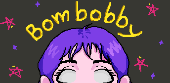
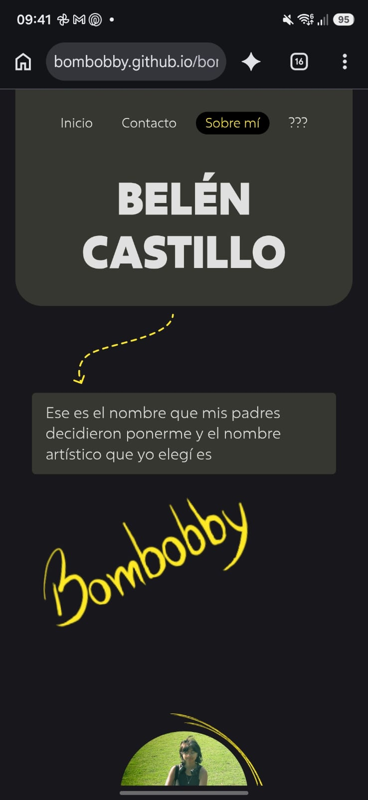
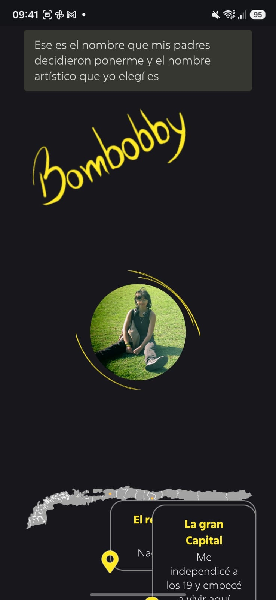

## Link de Figma
https://www.figma.com/design/o40EBU5M3OdI6YZ84nSSYk/Examen?node-id=0-1&t=6J2QyQ3Zd9v9rmg3-1

## Github pages
https://bombobby.github.io/bombobby-portafolio/index.html

## 1 Proyecto
Portafolio web personal enfocado en mostrar mi trabajo integral como diseñadora. El sitio se divide en dos áreas principales: los mejores proyectos desarrollados en la carrera y una sección dedicada a mis proyectos personales de ilustración y dibujo digital. 


## 2. Sitios Web de Referencia 
He elegido 5 referentes para empezar con el diseño de mi página web

1. **[Doko Studio](https://doko.studio/?ref=land-book.com):
- **Revelado de texto mediante scroll (Scroll-driven text reveal):** La animación donde los párrafos de presentación se van completando/iluminando a medida que el usuario avanza en la página, generando mayor ritmo de lectura.
 
2. **[Sean Halpin - Notes](https://www.seanhalpin.xyz/notes):
   - **Navegación Flotante Dinámica (Floating Sticky Navbar):** El menú superior que inicia de forma minimalista y que, al hacer scroll, se transforma añadiendo un contenedor encapsulado suavemente, manteniendo una navegación limpia de categorías (`Work / About / Play / Notes / Contact`).
   - **Interruptor de Modo Oscuro/Claro (Dark/Light Mode Toggle):** El cambio fluido de temas de interfaz mediante un toggle que adapta los colores de fondo, texto y acentos visuales sin perder el contraste ni la jerarquía. 

3. **[Stink Studios](https://www.stinkstudios.com/):
- **Asymmetric Grid Layout:** La maquetación de tarjetas de proyectos con bloques desiguales a dos columnas, alternando alturas y jerarquías visuales para romper la monotonía del scroll. 
- **Jerarquía Tipográfica Editorial + Multimedia:** La combinación de imágenes/videos de gran formato con títulos en negrita subrayados y etiquetas de categoría en miniatura (*tags*), logrando una presentación limpia y de alto impacto visual. 

4. **[My Poor Brain](https://mypoorbrain.com/):
- **Filtro / Navegación por vista split (Dual-category Toggle):** El menú interactivo que permite filtrar el contenido entre dos áreas principales (ej. Proyectos de Interfaces UDP vs. Ilustración Digital) o visualizar el catálogo completo ("All"), reestructurando las tarjetas sin necesidad de recargar la página. 

5. **[Daniel Spatzek](https://www.danielspatzek.com/home/):
- **Sección FAQ Interactiva con cambio de imagen en Hover:** Al pasar el cursor por cada pregunta de la lista, el cuadro de imagen/contenido adyacente se actualiza en tiempo real para complementar visualmente la respuesta con humor y dinamismo.
-  **Microinteracciones en filas/listas (Hover Feedback):** El cambio de color de fondo y de texto en las filas de la lista al pasar el cursor, dando una clara señal de interacción (feedback visual) al usuario.
  

## Clase 16-11-2026

El orden de mi menú de galería debería ser más o menos así

Todos los proyectos > Diseño > Ilustración

DISEÑO: Diseño industrial > Maquetas > Modelado 3D > Carpintería de taller

ILUSTRACIÓN: Digital > Análoga

De esta manera cambió mi idea original para el menú interactivo de proyectos.

Originalmente el menú iba a estar en la misma página 1, generando una animación en la que se desplegarían todas las opciones a elegir.
Se volvía un poco complicado generar un overlay en ella, así que las correcciones que me dió el profe Aaron igual me ayudaron a pensar en una forma más sencilla y simplemente llevar mis proyectos a una nueva página enlazada con la original.

Habrá un botón que al presionarlo te redirigirá a mis mejores proyectos (según yo y/ o considerando la nota que recibí en ese tiempo). Ya en esa página habrá un dropdown menu para “Todos los proyectos” donde aparecerá “Diseño” e “Ilustración” y de esas opciones nacerán otros dropdown menus con categorías más amplias de cada opción.



Algo más que cambió fue la pestaña "Sobre mí", originalmente estaba muy aburrida y mientras lo hacía me di cuenta de que tenía demasiado texto y estaba pareciendo un curriculum capaz de pasar esas tecnologías que ocupan las empresas par filtrarlos.

## 22-11-2026

Todos los días he estado trabajando un poco en el prototipo de figma.
Completé la diagramación, pero sin haberle agregado los nombres ni las descripciones a los proyectos aún porque no recordaba todo y habían proyectos a los que directamente no les había puesto nombre.
Terminé de elegir las categorías que pondría finalmente en el filtro del dropdown menu siendo las siguientes: 

**Proyectos de diseño**
- Materiales y fabricación
- Dibujo geométrico
- Prototipado
- Fabricación digital

**Proyectos de ilustración**
- Digital
- Tradicional

La diagramación de la página "Todos los proyectos" me estaba dando demasiados problemas y provocando dolores de cabeza brutales así que decidí abandonarla y simplemente generarla en el código.

Le puse los nombres a cada proyecto y aproveché de crear carpetas para tener todo más ordenados, ahora en mi pc tengo estas carpetas:

**PROYECTOS DE ILUSTRACIÓN**
**-Subcarpetas:**
- Tradicional
- Digital

Y dentro de tradicional y digital están otras subcarpetas por cada proyecto, lo mismo para diseño

**PROYECTOS DE DISEÑO**
**-Subcarpetas**
- Código
- Dibujo geométrico
- Fabricación digital
- Materiales y fabricación
- Prototipado

Para no explotar la página con texto le pedí a la IA que me ayudara a compactar las descripciones que le iba enviando, por ejemplo:

````
**yo:** Compacta la siguiente descripción que te enviaré, debe ser lo suficientemente corta para entrar en un cuadro de texto pequeño de unas 3 o 4 lineas máximo "dibujo hecho a mano con tiralineas, plumones y lapices de palo. Representa la locura a la que estaba adentrandome al no saber que hacer con mi vida ni saber que hacer para este dibujo que iba a ser presentado en el museo de Artes Visuales Surazo de Osorno (si fue expuesto en el museo)"

**Gemini:** Opción 1 (Técnica y narrativa expositiva):
Ilustración expresionista a mano con tiralíneas, plumones y lápices de colores, expuesta en el Museo de Artes Visuales Surazo de Osorno; plasma un entorno surrealista y asfixiante como metáfora de la crisis existencial, la desorientación vital y el colapso ante el proceso creativo.

Opción 2 (Enfoque en el caos psicológico y la materialidad):
Obra expositiva para el Museo Surazo realizada en técnica mixta (tiralíneas, plumones y lápices de colores), que retrata la transición de la cordura a la desesperación; el desorden de una habitación distorsionada y la mirada fragmentada del personaje reflejan un estado de incertidumbre absoluta sobre el futuro.

Opción 3 (Ultra compacta):
Dibujo expresivo en técnica mixta, expuesto en el Museo Surazo de Osorno, que exterioriza la angustia de la desorientación existencial y la presión creativa mediante un entorno de perspectivas rotas y miradas intrusivas.
````

Luego de haber hecho eso con cada uno de mis proyectos, trabajé en el carrusel de mi sección secreta
Agregué 2 flechas que ayudarían a cambiar al video anterior o al siguiente, solo hice 2 animaciones, porque no tenía tiempo suficiente para animar el carrusel entero.

Edité las tipografías una última vez, pues consideré que los títulos de los proyectos no se veían tanto como títulos.

Edité los nombres de los componentes, arreglé faltas de ortografía. Arreglé el autolayout ya que me dí cuenta de que, entre tanta edición, había borrado algunas cosas que antes si tenían autolayout.
El mobile tenía muchos errores en el prototipo de navegación, así que borré todos los flujos y los hice nuevamente.

Ahora me faltaba el banner, que lo aplacé eternamente hasta el final... pero ya tenía una idea. 
Hice un dibujo en píxelart que me representa a mi, volví a ocupar el fabuloso software Krita al cual le debo mis ganas de vivir e hice una ilustración que me representa a mi.



Ya era hora de empezar con el código... ya había avanzado anteriormente con el .html del inicio, creé otro 3 .html **proyectos.html, secreto.html y sobre-mi.html**
El html es easy peasy, así que prácticamente seguí el orden de los primeros html que hicimos en este ramo.
Cuando llegué a la parte de **Contacto** me di cuenta de que no sabía como conseguir los mismos íconos que usé en el figma. Volví a Gemini

````
**yo:** Ya empecé a hacer el código, he hecho los html correspondientes, pero dejé incompletos la sección de los iconos de las redes sociales, porque quiero usar exactamente los mismo que ocupé en figma y no sé como hacerlo.

**Gemini:** 1. Exportar los iconos desde Figma (mi recomendación)
1. Abre tu proyecto en Figma.
2. Selecciona el icono de Instagram, TikTok, Facebook, etc.
3. En el panel derecho, busca la sección Export.
4. Selecciona formato PNG.
5. Exporta cada icono.

wau
````

No entendí mucho del JavaScript así que tuve que preguntarle muchísimo a la IA
El css me parece especialmente complicado, tuve muchos problemas al hacer la sección "Sobre mí" en el css, creo que me explotó el cerebro e hice algo diferente pero no logro entender qué. La cosa es que esta sección se ve mucho más pequeñas que las otras

Mis carpetas con los proyectos quedaron en un orden distinto al del figma y eso provocó que no se vean en la misma secuencia, pero siguen siendo los mismos. 

Haber hecho tantas carpetas ayudó muchísimo en la creación del filtro en el dropdown menu.

Se me ocurrió que el banner podría ser más épico y quise que los ojos de mi personaje siguieran el cursor a donde sea que este se dirija. Así que tuve que separar mi dibujo por capas: una base y la otra únicamente de las pupilas

  

Otra cosa que se me ocurrió fue que el cursor se convierta en un ojito cuando pasa sobre un proyecto y que al hacer esto se vayan mostrando otras imágenes del trabajo o que se empiece a reproducir un video.

No sabía como poner los dibujos a mano que había hecho en figma en el lugar exacto en que yo quería que fueran, así que le dije a Claude que lo haga por mí.

Intenté poner un botón que active el sonido de mis videos en la sección "???", pero creo que no funcionó.

A medida que iba editando el código me daba cuenta de que me faltaban imágenes o íconos, así que hay algunas cosas que se ven un poco desordenadas en la carpeta improvisada "bombobby-milo"

**Son las 9:59 del día 23-11-2026**
ya sé por qué no se escuchaban mis videos en la sección "???", es que mis videos no tenían audio y no me di cuenta, así que los cambié por unos que si tuvieran audio.

Finalmente subí mi pagina a Github pages, pero tuve problemas haciéndolo desde la web, tenía carpetas con más de 100 archivos y eso provocó que no me dejara subirlos, así que terminé instalando Github Desktop y fue todo mucho más fácil.
También me di cuenta de que tenía archivos de más de 100MB, así que tuve que comprimirlos.

Con la página ya subida y todo funcionando, me di cuenta de que la sección "Sobre mí" en mobile se veía desordenada. 

  

Así que tuve que agregar una sección especial para esta sección en mobile en el css y un nuevo archivo para el mapa, pero versión vertical.

Ahora ya todo funciona.

## Uso de IA

* **Herramientas utilizadas:** Gemini (apoyo en redacción/síntesis, ideas y dudas de diseño/prototipado) y Claude (apoyo en código).
* **Síntesis de textos y descripciones:** Usé IA para compactar descripciones extensas de proyectos y obras a textos breves (3–4 líneas), manteniendo el contexto expositivo y ajustando el tono final a mi propia voz.
* **Resolución de dudas de estructura, filtros y prototipado:** Consulté dudas sobre taxonomía y filtros/desplegables, comportamientos de navegación/scroll y microinteracciones en Figma, adaptando las soluciones a mi propuesta visual y a las correcciones recibidas.
* **Apoyo en código e interacciones:** Utilicé apoyo en código y revisión iterativa para estructurar y ajustar HTML, CSS y JavaScript en archivos como `index.html`, `proyectos.html`, `proyectos.js`, `script.js`, `secreto.html`, `sobre-mi.html` y `style.css`, incluyendo:
  * El movimiento de los ojos del banner siguiendo la posición del cursor.
  * El cursor personalizado en forma de ojo al pasar sobre imágenes o videos de proyectos.
  * La animación de texto que cambia de color progresivamente a medida que se baja con el scroll
  * La implementación de un botón de volumen en el reproductor/carrusel de video, el cual finalmente no me sirvió del todo porque sigo sin escuchar los videos.
* **Autoría propia:** La identidad visual, la creación de mis trabajos de diseño e ilustración, el diseño en Figma y las decisiones finales del portafolio son de mi autoría.


