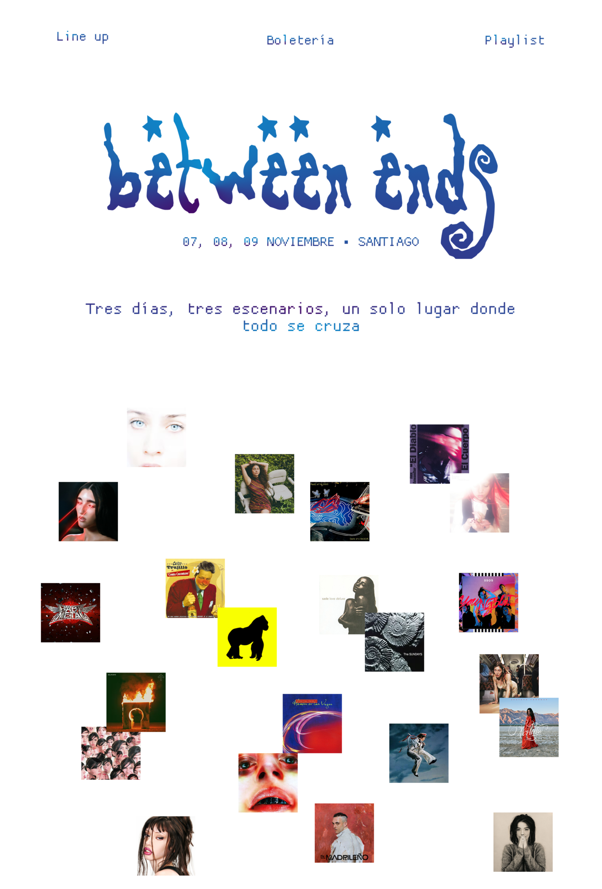

# Clase 28-09
## Consulta a la IA: Cambiar el tamaño de una imagen

**Prompt: como puedo cambiar el tamaño de una imagen en html** 

IA

```css
.mi-imagen {
    width: 50%;
}
```
Crear una clase donde está la imagen .imagen

VS CODE

```css
<div>
 
</div>
```

Luego en la página de style.css

```css
.imagen{
    width: 100%;
}
```

Al final no lo usé porque la imagen no quedaba centrada, y al principio no entendía por qué la imagen se veía tan grande,
pero al final era porque la imagen era en archivo png y lo que yo creía era el fondo de la imagen, en realidad era el fondo de la página jeje

Le saqué la modificación de tamaño y la imagen quedaba bien.

**otras opciones y por qué no las utilicé**

En html:

```css


Para mantener la proporción solo especificar el ancho:


```

En css:

```css


.mi-imagen {
    width: 300px;
    height: auto;
}
```

No utilice las de html porque prefería tener las cosas relacionadas a la apariencia en el css, y no probé la opción de css porque creí que era más sencillo
usar la opción de porcentaje.

# Bitácora Solemne 2

# Solemne 2

¿Qué hice en el sitio?

¿Qué dificultades tuve y como las resolví?

¿Qué aprendí?

Para el proceso de creación del sitio me encargué del paso inicial, organizar la información en el HTML y revisar como lograr hacer la animación de las portadas de los álbumes. 

Al principio tenía varias dudas de cómo se debían organizar las secciones en la página, por lo que en realidad partí ordenando todo según lo que recordaba y entendía de los ejemplos que habíamos trabajado en clases con la profe. Me confundía mucho con la organización en div de las secciones, si es que cada título o párrafo, por ejemplo en el LineUp debía juntar el escenario con los artistas o si era todo por separado, así que escribí todo separado porque pensaba que como eran cosas aparte tipo que el nombre del escenario era algo mas importante que los nombres de los artistas, luego me fije que en el Figma tenían el mismo tamaño de letra. 

Luego le pregunté a Claude si existía alguna forma de poder hacer la animación que teníamos pensado poner con las portadas de los álbumes 

> Adjunto png de mi diseño de página web en Figma (escritorio de 1440 px), existe alguna forma de hacer que la parte de las imágenes de portadas de álbumes se pueda colocar de esa manera o hacer este tipo de animación que se vayan moviendo como la animación standby de DVD?

Además, le adjunte una foto de esa sección de la página web.



---------------------------------------------------------------
a lo que me respondió

 > ¡Sí se puede, y se ve harto bien! Necesitas HTML + CSS para dejar las portadas dispersas como en tu Figma, y un poquito de JavaScript para el rebote tipo DVD (solo con CSS no se logra el rebote contra los bordes). Te dejo todo listo para copiar y pegar.

```html
<section class="covers">
  
  
  
  
  
  
  
  
  
  
  
  
  
  
  
  
  
  
  
  
  
  
</section>
```

 > Esos porcentajes los saqué a ojo de tu PNG, así que las posiciones iniciales quedan casi iguales a tu diseño. Puedes ajustarlas a mano si algo se ve corrido.

```css 
.covers {
  position: relative;
  width: 100%;
  height: 1300px;      /* alto de la zona de portadas */
  overflow: hidden;    /* para que no se salgan de la sección */
}

.covers img {
  position: absolute;
  width: 9.7%;         /* ~140px en 1440px de ancho */
  aspect-ratio: 1 / 1;
  object-fit: cover;
  will-change: transform;
}
```

 > JavaScript (ponlo antes de </body> o en un archivo script.js)

```html
<script>
  window.addEventListener('load', () => {
    // Si la persona tiene activado "reducir movimiento", no animamos
    if (window.matchMedia('(prefers-reduced-motion: reduce)').matches) return;

    const box = document.querySelector('.covers');
    const speed = () => (Math.random() * 0.6 + 0.3) * (Math.random() < 0.5 ? -1 : 1);

    const items = [...box.querySelectorAll('img')].map(el => {
      const x = el.offsetLeft;
      const y = el.offsetTop;
      // pasamos la posición a transform para mover todo con un solo método
      el.style.left = '0';
      el.style.top = '0';
      return { el, x, y, vx: speed(), vy: speed() };
    });

    function animate() {
      const maxX = box.clientWidth;
      const maxY = box.clientHeight;

      items.forEach(it => {
        const w = it.el.offsetWidth;
        const h = it.el.offsetHeight;

        it.x += it.vx;
        it.y += it.vy;

        // rebote como el logo del DVD
        if (it.x <= 0 || it.x + w >= maxX) {
          it.vx *= -1;
          it.x = Math.max(0, Math.min(it.x, maxX - w));
        }
        if (it.y <= 0 || it.y + h >= maxY) {
          it.vy *= -1;
          it.y = Math.max(0, Math.min(it.y, maxY - h));
        }

        it.el.style.transform = `translate(${it.x}px, ${it.y}px)`;
      });

      requestAnimationFrame(animate);
    }

    animate();
  });
</script>
```

 > ¡Sí se puede, y se ve harto bien! Necesitas HTML + CSS para dejar las portadas dispersas como en tu Figma, y un poquito de JavaScript para el rebote tipo DVD (solo con CSS no se logra el rebote contra los bordes). Te dejo todo listo para copiar y pegar.

**HTML**

```html
<section class="covers">
  
  
  
  
  
  
  
  
  
  
  
  
  
  
  
  
  
  
  
  
  
  
</section>
```

Esos porcentajes los saqué a ojo de tu PNG, así que las posiciones iniciales quedan casi iguales a tu diseño. Puedes ajustarlas a mano si algo se ve corrido.

**CSS**

```css
.covers {
  position: relative;
  width: 100%;
  height: 1300px;      /* alto de la zona de portadas */
  overflow: hidden;    /* para que no se salgan de la sección */
}

.covers img {
  position: absolute;
  width: 9.7%;         /* ~140px en 1440px de ancho */
  aspect-ratio: 1 / 1;
  object-fit: cover;
  will-change: transform;
}
```

**JavaScript** (ponlo antes de `</body>` o en un archivo `script.js`)

```html
<script>
  window.addEventListener('load', () => {
    // Si la persona tiene activado "reducir movimiento", no animamos
    if (window.matchMedia('(prefers-reduced-motion: reduce)').matches) return;

    const box = document.querySelector('.covers');
    const speed = () => (Math.random() * 0.6 + 0.3) * (Math.random() < 0.5 ? -1 : 1);

    const items = [...box.querySelectorAll('img')].map(el => {
      const x = el.offsetLeft;
      const y = el.offsetTop;
      // pasamos la posición a transform para mover todo con un solo método
      el.style.left = '0';
      el.style.top = '0';
      return { el, x, y, vx: speed(), vy: speed() };
    });

    function animate() {
      const maxX = box.clientWidth;
      const maxY = box.clientHeight;

      items.forEach(it => {
        const w = it.el.offsetWidth;
        const h = it.el.offsetHeight;

        it.x += it.vx;
        it.y += it.vy;

        // rebote como el logo del DVD
        if (it.x <= 0 || it.x + w >= maxX) {
          it.vx *= -1;
          it.x = Math.max(0, Math.min(it.x, maxX - w));
        }
        if (it.y <= 0 || it.y + h >= maxY) {
          it.vy *= -1;
          it.y = Math.max(0, Math.min(it.y, maxY - h));
        }

        it.el.style.transform = `translate(${it.x}px, ${it.y}px)`;
      });

      requestAnimationFrame(animate);
    }

    animate();
  });
</script>
```

**Cómo funciona, en resumen:**
- Cada portada parte en la posición que le pusiste en el HTML y le asigna una velocidad y dirección al azar.
- En cada frame (`requestAnimationFrame`) se mueve un poquito, y si toca un borde de la sección, invierte la dirección, igual que el DVD.
- Se mueven con `transform` y no con `left/top`, así la animación va fluida y no se pega.

**Ajustes rápidos:**
- Más lento o más rápido: cambia `0.3` y `0.6` en la función `speed`.
- Que se pausen al pasar el mouse: agrega `el.addEventListener('mouseenter', ...)` y una bandera `paused` por portada (si lo quieres, te lo armo).
- Si prefieres algo más suave y flotante, sin rebote, se puede hacer solo con `@keyframes` en CSS, pero pierdes el efecto DVD.

Ojo con las rutas `img/01.jpg`: tienes que exportar cada portada desde Figma (o usar las originales) y dejarlas en esa carpeta con esos nombres, o cambiar los `src`.

------------------------------------------------------------------------------------------

Luego de todo ese enredo de cosas que me mando porque sabiendo que me iba a entregar un código para usar con JavaScript se me olvidó colocarle en el prompt que no tenía conocimiento en el tema 

> Podrías enseñarme más o menos como lo hiciste, no sé nada de js

---------------------------------------------------------------------------

en esta parte iré poniendo los códigos que me entregó por parte e iré escribiendo mas o menos lo que entendí de lo que hizo 

```
const box = document.querySelector('.covers');
```
const como algo que no se puede cambiar, que se mantiene a lo largo del tiempo y se llamará `box`. (https://www.w3schools.com/js/js_const.asp)

en c++ los puntos significan "busca en este lugar o así lo entiendo yo, según Claude, en JS funciona del mismo modo por lo que entendí. Entonces,

```
document.querySelector('.covers')
```

Se debe buscar la clase llamada .covers

Se le pone un punto antes porque así se llaman a las clases.

También existen las funciones, por lo que entiendo podrían considerarse el opuesto de `const` ya que son reutilizables y se ejecutan cuando se les llama. (https://www.w3schools.com/js/js_functions.asp) 

```
if (it.x <= 0) { ... }   // si x es menor o igual a 0...
```

Según entiendo if es un condicional "si pasa esto, hace esto"

las variables en JS funcionan muy parecido en c++

Entonces, el código parte pidiéndole a window (la página) que busque algo que este pasando aquí, por lo que al entrar en la página, esta debe entender en tiempo récord que es lo que esta pasando y comenzar a mover cosas.

> Cuando la usamos dentro de addEventListener, se llama función callback: una función que le pasas a otra para que la ejecute más tarde, cuando sea el momento. Es como dejarle una nota al guardia: “cuando pase X, haz lo que dice esta nota”.

Entonces, la estructura completa de tu primera línea es:

```
window.addEventListener( 'load' , () => { ... } );
//  ↑ventana  ↑guardia     ↑evento   ↑qué hacer (la nota)
```

Según Claude 

```
window.matchMedia('(prefers-reduced-motion: reduce)').matches
```

matchMedia funciona como el media queries de CSS 

el `prefers-reduced-motion: reduce` es una opción que los usuarios controlan desde sus dispositivos, probablemente en configuraciones. Cuando sienten mareos o molestias por los movimientos, reducen la animación o la cancelan. 

Por lo tanto, Si el usuario tiene alguna configuración personal en su dispositivo, el código debe actuar según las condiciones que se le permiten.

y aquí aparece el `return` que terminaría la acción, dejando las imágenes en su lugar pre establecido. 

Si no es el caso, entonces:

```
const speed = () => (Math.random() * 0.6 + 0.3) * (Math.random() < 0.5 ? -1 : 1);
```

Se crea una función para que las imágenes se puedan mover en el alto y ancho de la caja en la que están contenidas.

Math.random() -> número al azar.

```
/*busca en box todas las imágenes y haz lo siguiente*/
const items = [...box.querySelectorAll('img')].map(el => {
/*coloca las imágenes donde defini antes en el html*/
  const x = el.offsetLeft;
  const y = el.offsetTop;
/*esto se coloca porque se usara otro método para el movimiento*/
  el.style.left = '0';
  el.style.top = '0';
/*se guardan las posiciones de las imagenes*/ 
  return { el, x, y, vx: speed(), vy: speed() };
});
 
Luego define el movimiento de la animación, los márgenes hasta donde puede avanzar y luego rebotar.

```
if (it.x <= 0 || it.x + w >= maxX) {
  it.vx *= -1;
}
```
Si la imagen toca el borde izq/borde sup o el borde der/borde inf, invierte su dirección.

Tanto para eje X e Y.

Esta parte no la entendí bien

``` 
it.el.style.transform = `translate(${it.x}px, ${it.y}px)`;
```

"esta es la linea que realmente la mueve" dice, aplica los cálculos realizados para que las imágenes se muevan.

------------------------------------------------------------

Con esto listo, cambiamos los nombres de las imágenes de las portadas para que todas tuvieran un nombre similar y fuese mas fácil después para poder escribirlos en la lista de posiciones. Luego, le pedí a Claude que me corrigiera lo que tenía escrito hasta ese momento en el HTML, me faltaba solo colocar el footer.

```
<!DOCTYPE html>
<html lang="es">
<head>
    <meta charset="UTF-8">
    <meta name="viewport" content="width=device-width, initial-scale=1.0">
    <title>BetweenEnds</title>
    <link rel="stylesheet" href="style.css">
</head>
<body>
    <header class="navbar">
        <nav>
            <ul class="nav-links">
                <li><a href="#LineUp">Line Up</a></li>
                <li><a href="#boleteria">Boletería</a></li>
                <li><a href="#playlist">Playlist</a></li>
            </ul>
        </nav>
    </header>

    <main>
        <section class="banner">
            <div class="logo">
             
            </div>
            <div class="banner-text">
                <p>07, 08 y 09 de noviembre - Santiago</p>
                <p>Tres días, tres escenarios, un solo lugar donde todo se cruza</p>
        </section>

        <section class="covers">
          
          
          
          
          
          
          
          
          
          
          
          
          
          
          
          
          
          
          
          
          
          
        </section>
        
        <script>
          window.addEventListener('load', () => {
            // Si la persona tiene activado "reducir movimiento", no animamos
            if (window.matchMedia('(prefers-reduced-motion: reduce)').matches) return;

            const box = document.querySelector('.covers');
            const speed = () => (Math.random() * 0.6 + 0.3) * (Math.random() < 0.5 ? -1 : 1);

            const items = [...box.querySelectorAll('img')].map(el => {
              const x = el.offsetLeft;
              const y = el.offsetTop;
              // pasamos la posición a transform para mover todo con un solo método
              el.style.left = '0';
              el.style.top = '0';
              return { el, x, y, vx: speed(), vy: speed() };
            });

            function animate() {
              const maxX = box.clientWidth;
              const maxY = box.clientHeight;

              items.forEach(it => {
                const w = it.el.offsetWidth;
                const h = it.el.offsetHeight;

                it.x += it.vx;
                it.y += it.vy;

                // rebote como el logo del DVD
                if (it.x <= 0 || it.x + w >= maxX) {
                  it.vx *= -1;
                  it.x = Math.max(0, Math.min(it.x, maxX - w));
                }
                if (it.y <= 0 || it.y + h >= maxY) {
                  it.vy *= -1;
                  it.y = Math.max(0, Math.min(it.y, maxY - h));
                }

                it.el.style.transform = `translate(${it.x}px, ${it.y}px)`;
              });

              requestAnimationFrame(animate);
            }

            animate();
          });
        </script>

        <section class="lineup" id="LineUp">
            <h2>Line Up</h2>
        </section>
        <section class="lineup">
            <div class="lineup-container">
                <div class="dia">
                    <h3>Viernes 07</h3>
                </div>
                <div class="main-stage">
                    <p>MAIN STAGE</p>
                    <p>ROSARIO ALFONSO</p>
                    <p>CLAIRO</p>
                    <p>SADE</p>
                    <p>BJÖRK</p>
                </div>
                <div class="stage-2">
                    <p>STAGE 2</p>
                    <p>JULIETA VENEGAS</p>
                    <p>ALEX ANWANDTER</p>
                    <p>FIONNA APPLE</p>
                    <p>CAROLINE POLACHEK</p>
                </div>
                <div class="warehouse">
                    <p>WAREHOUSE</p>
                    <p>AKRIILA</p>
                    <p>THE SUNDAYS</p>
                    <p>COCTEAU TWINS</p>
                    <p>SILVANA ESTRADA</p>
                    <p>DANIEL CAESAR</p>
                    <p>CONAN GRAY</p>
                </div>
        </section>
        <section class="lineup">
                <div class="dia">
                    <h3>Sábado 08</h3>
                </div>
                <div class="main-stage">
                    <p>MAIN STAGE</p>
                    <p>JAVIERA MENA</p>
                    <p>KALI UCHIS</p>
                    <p>CHARLI XCX</p>
                    <p>SHAKIRA</p>
                </div>
                <div class="stage-2">
                    <p>STAGE 2</p>
                    <p>JUDELINE</p>
                    <p>SEN SENRA</p>
                    <p>C. TANGANA</p>
                    <p>AZAELIA BANKS</p>
                    <p>LADY GAGA</p>
                </div>
                <div class="warehouse">
                    <p>WAREHOUSE</p>
                    <p>SIXSEX</p>
                    <p>RUSOWSKY</p>
                    <p>ÑENGO FLOW</p>
                    <p>JOWELL & RANDY</p>
                    <p>PLAN B</p>
                    <p>ELADIO CARRIÓN</p>
                </div>
        </section>
        <section class="lineup">
                <div class="dia">
                    <h3>Domingo 09</h3>
                </div>
                <div class="main-stage">
                    <p>MAIN STAGE</p>
                    <p>5 SECONDS OF SUMMER</p>
                    <p>ONE DIRECTION</p>
                    <p>CHAPPELL ROAN</p>
                    <p>ARCTIC MONKEYS</p>
                </div>
                <div class="stage-2">
                    <p>STAGE 2</p>
                    <p>PANIC! AT THE DISCO</p>
                    <p>SLEEPING WITH SIRENS</p>
                    <p>PIERCE THE VEIL</p>
                    <p>ONE OK ROCK</p>
                    <p>BABYMETAL</p>
                </div>
                <div class="warehouse">
                    <p>WAREHOUSE</p>
                    <p>NUÑEZ BRICEÑO</p>
                    <p>DELLAFUENTE</p>
                    <p>CHICO TRUJILLO</p>
                    <p>SANTA FERIA</p>
                    <p>YUNG BEEF</p>
                    <p>ARCA</p>
                </div>
        </section>
        <section class="boleteria" id="boleteria">
            <h2>Boletería</h2>
          <div class="boleteria">
            <h2>X 1 DÍA</h2>
            <p>PRECIO NORMAL: $109.250</p>
            <p>20% DCTO SANTANDER: $87.400</p>
          </div>
          <div class="boleteria">
            <h2>X 2 DÍAS</h2>
            <p>PRECIO NORMAL: $172.500</p>
            <p>20% DCTO SANTANDER: $138.000</p>
          </div>
          <div class="boleteria">
            <h2>X 3 DÍAS</h2>
            <p>PRECIO NORMAL: $205.250</p>
            <p>20% DCTO SANTANDER: $161.000</p>
          </div>
        </section>
        <section class="button">
          <div class="button-box">
            <a href="https://www.ticketplus.cl/evento/between-ends-2025" target="_blank">COMPRA AQUÍ</a>
          </div>
          <div class="button-box">
            <a href="https://www.ticketplus.cl/evento/between-ends-2025" target="_blank">COMPRA CON 20% DCTO</a>
        </section>

        <section class="playlist" id="playlist">
            <h2>Playlist</h2>
            <iframe data-testid="embed-iframe" style="border-radius:12px" src="https://open.spotify.com/embed/playlist/5ojiZltQ1QsDWh8yne4GMw?utm_source=generator&si=a08333af674b4be4" width="100%" height="352" frameBorder="0" allowfullscreen="" allow="autoplay; clipboard-write; encrypted-media; fullscreen; picture-in-picture" loading="lazy"></iframe>
        </section>
     
     
     

    </main>

    <footer>

    </footer>
</body>
</html>
```
Este fue el prompt con el que le pedí que me corrigiera 

> Adjunto png de mi diseño en Figma (escritorio de 1440 px) y mi HTML. Podrías corregirme el HTML, sé que debo tener cosas mal escritas como quizás las clases en los div del lineup por día, pero no estoy segura. También sé que no agregué una parte de playlist, eso no lo pesques jeje


Y estas fueron las cosas que me corrigio y se pueden visualizar en el HTML entregado, igual mis compañeras generaron más cambios luego de eso 

> Listo Martina, te dejé el `index.html` corregido completo. Tenías razón con lo del lineup, y había otras cositas. Esto es lo que arreglé:

**Errores de estructura (los que más rompían el layout)**
- `.banner-text` no estaba cerrado (faltaba su `</div>`), así que todo lo siguiente quedaba anidado raro.
- `.lineup-container` se abría en el primer día y nunca se cerraba, y sábado y domingo quedaban sueltos afuera. Ahora hay un `.lineup-container` por día, todos dentro de una sola `<section class="lineup" id="LineUp">`.
- El segundo `.button-box` tampoco estaba cerrado.
- La sección `.boleteria` tenía adentro divs con la misma clase `.boleteria`. Les puse `.ticket` y los títulos pasaron a `h3`.

**Contenido**
- El precio de 3 días estaba en $205.250, pero en tu Figma dice $201.250, y con ese el 20% da justo $161.000. Lo corregí.
- Typos: "Fionna" → "Fiona Apple" y "Azaelia" → "Azealia Banks".
- Los días ahora dicen "07 de noviembre" como en tu diseño, en vez de "Viernes 07".
- El `alt` del logo decía "BeforeEnds", ahora "between ends". También cambié el `<title>`.
- `&` suelto → `&amp;` (Jowell & Randy y la URL de Spotify).

**Otras mejoras**
- El `<script>` lo moví al final del body, ya que estaba en medio del main.
- Agregué `rel="noopener noreferrer"` a los links externos y un `title` al iframe.
- Metí el logo dentro de un `<h1>`. Si se te mueve algo, ponle `h1 { margin: 0; }` en el CSS.

**Ojo con esto**
- Los links de compra apuntan a `between-ends-2025`, revisa si va el 2026.
- Armé el footer del diseño, que estaba vacío. Es solo HTML, así que le falta su CSS, y las imágenes de auspiciadores (`redbull.png`, `santander.png`, `cocacola.png`) tienen nombres inventados, cámbialos por los tuyos. Los links de redes están con `#`.
- Como cambié `.boleteria` interno a `.ticket` y el lineup quedó en contenedores por día, en tu `style.css` pasa `.boleteria div` a `.ticket`. Para que el día ocupe todo el ancho sobre las 3 columnas, el `.lineup-container` debería ser un grid con `.dia { grid-column: 1 / -1; }`.

Si quieres, pégame tu `style.css` y te lo ajusto a esta estructura y te armo el CSS del footer.

Habían algunos errores relacionados a los años o texto que no coincidía con lo que se veía en el diseño de Figma porque eran los textos automáticos que me entregaba VS Code, supongo que es por la instalación de alguna de las extensiones que nos recomendaron instalar.

En el proceso de escritura del código pude darme cuenta de que hay que ser demasiado ordenado y entender bien que cosas estas poniendo y donde las estas poniendo. El tiempo pasa super rápido, sentía que escribía y escribía pensando que llevaba harto, pero en realidad habían pasado dos horas y yo recién había terminado de escribir el header; realmente no es tan complejo entender las cosas, pero si se debe ser muy minucioso y estar revisando constantemente los cambios realizados en la página para ver si es que se están haciendo o si las cosas se van viendo cómo se diseñó en un principio. También estar trabajando el HTML en conjunto con el CSS ya que así puedes ir viendo si la forma en la que está construida la página es la correcta o pusimos algo que no funciona tan bien.


