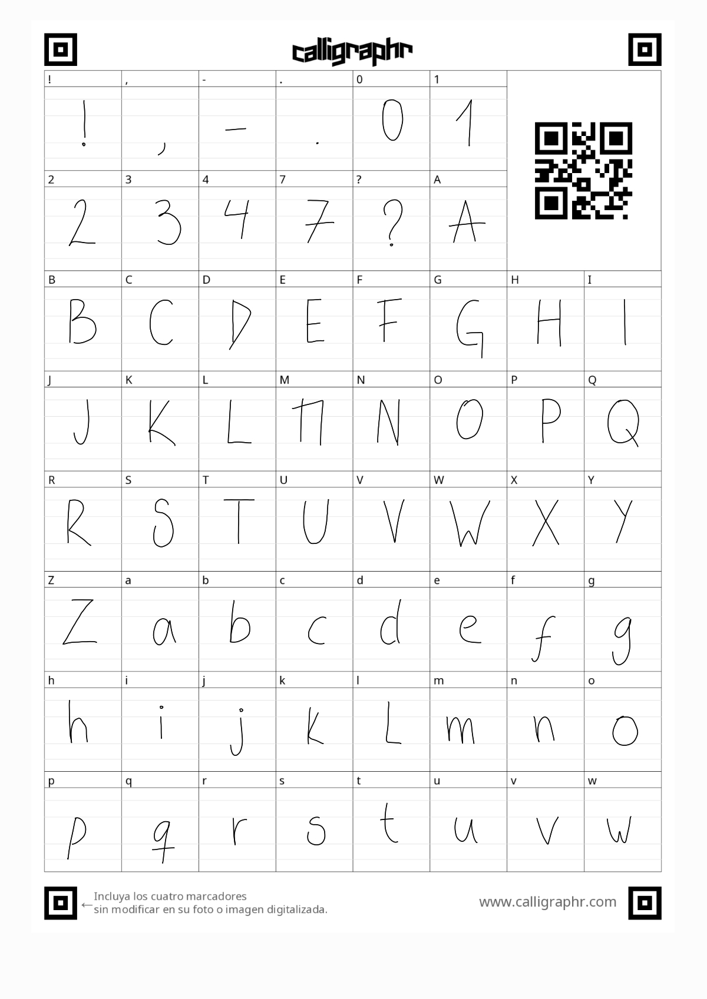
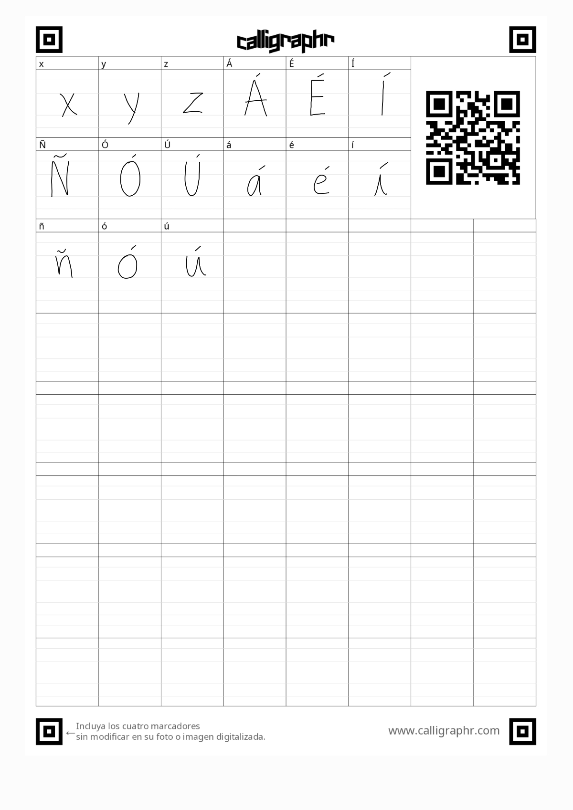

# ¿Qué quiero hacer?

Hace rato pensaba en experimentar haciendo una página donde colocar las fotos que tomo junto a quizás algunos pensamientos, música, citas, etc.

Aunque también es una buena oportunidad para poder crear mi portafolio.

Entonces, ¿con qué me quedo?

Probaré haciendo un poco de ambas.

## Figma

[Figma.com](https://www.figma.com/design/IFHkWNJJfkxryQmSn1jA4c/examen?node-id=0-1&t=HUCxR2Z3rXw0G8GA-1)

## Pensamientos mientras organizo que poner

 **Secciones para la página**

> Sobre mi

Debería colocar aquí mi contacto? puedo?

Debería crearme un logo? algo sencillo? una calabaza? y si uso a mi pequeña pumpkin?

> Portafolio (segunda página)

 ¿Qué trabajos podría colocar?

  -Golondrina para Parque MET
  -Exposición un siglo de voces juveniles
  -Silla de máquinas y procesos
  -Si alcanzo, lampara de cerámica

¿Qué colores usaría?

  -Tonos azules, naranjos, verdes, morados

> Mi colección de fotos

  -Buscar las más bacanes
  -Ver como agregar videos igual

Agregar texto / pensamientos / letras de canciones ???

Agregar playlist?? debería colocar alguna, la música es algo importante para mi

¿Qué tan difícil sería colocar una versión web del proyecto 2 de taller? (jueguito tipo flappy bird)

## Referentes

1.Gunes Atakan Peksen

De esta página rescato la visualización e interacción con las imágenes 

[gunespeksen.com](https://gunespeksen.com/)

2.Rene Coignard

De esta página quiero tomar lo minimalista que es la página en un principio pero luego se "desmorona", no sé si tomar la acción de que las cosas se caigan solas, pero si quizás ir generando desorden a medida que avanza en la página.

Corrección de Aarón: todo se desmorona, menos sus principios.

[renecoignard.com](https://renecoignard.com/)

3.ohhmydesign

De esta página tomo el uso de la tipografía. Quiero usar idealmente dos tipografías diferentes para representar dos estados (emocionales? mentales?) ir variando para mostrar como ciertas cosas afectan un poco mi estado.

[ohhmydesign.com](https://www.ohhmydesign.com/)

(otros)

Fotolog / ya no

Aunque era muy chica para utilizar fotolog en su apogeo, siempre me encantó la idea de publicar solo fotos, de haber tenido edad suficiente para usarla, probablemente seria uno de los perfiles con más fotos de la comunidad. De esta página tomo la idea de publicar solo fotografías e imágenes y la forma simple de organización y visualización de estas.

La web en la que me quiero basar ya no se encuentra disponible pero algo así se veía

-----------------------------------------------------

Y se me le ocurrió otra idea

Qué pasa si hacemos un tipo de juego como este que tiras una palanca y y se ruedan unas cosas para después de un rato, detenerse y mostrar distintos dibujos, pero con las fotos que decida, juegos de azar que te dicen que fotos serás hoy KJDFKJ o algo así

## Correcciones con Aarón Montoya

- Buscar referentes de la sección "Sobre mi"
- Buscar referentes de la sección "Contacto". Cómo y para qué te contacto.
- nnnnnnnn.co
- newrafael.com
- Hacer descripciones de elecciones mas profundas y específicas.
- Espacio negativo (Rene Coignard)
- Definir tipografía: material y emocional para mostrar lo que quiero expresar con eso.
- Quizás es buena idea escanear mi letra.
- patshiu.com
- Actividad para soltar la mano: hacer wireframes de páginas que me hayan gustado.

------------------------------------------------------
Para comenzar a diseñar la página busco las cosas que necesitaré para construirla, como las imágenes que quiero colocar y crear la tipografía que quiero hacer con mi letra. Busqué seleccioné y descargué las fotos que quería mostrar. 

Para la tipografía, le pregunté a la IA cual era la mejor forma de hacer lo que quería hacer, me recomendó páginas para poder hacer mi propia tipografía [Calligraph.com](https://www.calligraphr.com/). En esta página, gratuitamente puedes descargar una plantilla que contenga 75 caracteres, los cuales escogí mayúsculas, minúsculas y las vocales con tilde. Con una tablet dibuje cada letra. La plantilla se sube a la plataforma y se generan los archivos .ttf u .otf descargables.

> debo hacer una página web en html y css, es posible agregar mi propia tipografía? tipo hacer una tipografía escaneando mi letra para poder usarla en mi página?

> ## Convertir tu letra en fuente
>
>La opción más fácil es Calligraphr (calligraphr.com). Hasta donde sé, tiene un plan gratis con un límite de caracteres que alcanza para lo básico.
>
>Descargas una plantilla, que es una hoja con cuadritos, uno por letra.
>La imprimes y escribes cada letra en su cuadro con un plumón negro, ojalá de punta fina a media.
>La escaneas, o le sacas una foto bien derecha y con buena luz, y la subes.
>Te genera la fuente y la descargas en .ttf o .otf.

> ** Ojo: agrega a la plantilla á é í ó ú ñ ¿ ¡ y los signos que vayas a usar. Si no, esos caracteres van a salir en otra fuente y se va a ver raro.

También escogí una tipografía que me permitiera mostrar un lado más "ordenado" que representa un estado más "formal" se podría decir, para luego usar mi tipografía para mostrar un estado más personal.

La tipografía "formal" que escogí fue la Gowun Batang.

### Home

Para el diseño del home y basándome en uno de mis referentes, quería colocar una imagen principal, al principio no sabía que colocar, tenía varías ideas para representar algún aspecto de mi personalidad pero me dí cuenta que tenía dos fotos mías con una calabaza, por lo que la utilicé como base para hacer este dibujo a línea de mi y usarlo en la parte principal del home. En un principio podemos verme oculta detrás de esta calabaza con cara, pero al pasar el cursor por encima me salgo de mi "escondite" y se borra la cara de la calabaza.

Siguiendo hacía abajo quería colocar una especie de dinámica con una de las partes mas importantes que quiero mostrar en la página, la cual será una ruleta como la de las maquinas tragamonedas. Se me ocurrió la idea porque cuando chica acompañaba mucho a mi tía a jugar la frutillita y creí que sería una buena dinámica algo como "¿qué trío de fotos eres hoy?" también porque me gustan los post de Instagram que te dicen tu animal/insecto/comida/etc según tu mes de nacimiento o cosas así. 

Partí creando el componente en el UI Kit. Coloque 9 cuadros por columna, de los cuales 1 era más grande que los demás para demostrar que era el "seleccionado". Luego, los agrupe dentro de un frame y estos los copie y pegué al lado para simular las 3 columnas de las máquinas. Cree un nuevo frame más pequeño que contuviera a estas 3 columnas y "recortara" el contenido para que no se viera que estaba todo dispuesto verticalmente. Cree 3 variantes para simular la interacción al apretar el botón.

De mi selección oficial y certificada de fotos, seleccione algunas para usarlas en el prototipo de figma.

Para los botones, Primero escribí lo que iban a decir, cree el componente, trazo para encerrarlo, lo edité para que no se viera tan recto redondeando los bordes, y cree una variante para hacer el efecto hover al pasar por encima de el.

Varías veces tuve que rehacer los botones porqué no me funcionaba el efecto de cambio cuando pasara el cursor.

Conecte las variantes, los botones y lo puse como si estuviera en un loop, por lo que cada vez que se apretara el botón de 
"girar" se mostrarían las 3 variantes creadas.

Agregué un botón que te llevará a otra página donde se encuentren todas las fotos que he sacado y he encontrado interesantes de compartir. Ya veremos si logro hacer este "depósito" de fotos o si no dejar solamente la ruleta .

¿Qué quiero mostrar sobre mi?

Me recomendaron buscar referentes sobre esto pero a la fecha aún no lo hago. 

Pero si hay algo que si o si quiero mostrar en esta parte es a mi gato y mi gusto por ir a conciertos. Pienso, debería poner una opción donde al seleccionar la imagen del concierto al que fui se reproduzca una canción o que lo dirija a su perfil de Spotify??? quizás, ya veremos.

En este lugar pensaba poner algunos videos, de mi y de mi gato tengo más videos que fotos de nosotros dos.

Para el prototipo agregué un par de imágenes y vídeos que mostraran la mejor versión de estas gentes ajajaja

Pensé en escribir los párrafos en forma de poemas, versos, para reflejar un espacio más personal.

Para el Portafolio, escogí algunos trabajos que me resultan dignos de mostrar. 

- Replica en madera de pino de la silla ARV Chair. Máquinas y procesos (2025-1)
- Juuko, una lampara con alta inspiración en el mobiliario japonés junto a taller colectivo (2025-2)
- Golondrina chilena para ParqueMET junto al Taller Colectivo (2025-2)
- Mesita de centro. Acero carbono de 3mm plegado y pintado con negro. Fabricación Digital Avanzada (2026-1)

*Nota del autor: los vídeos en figma suenan todo el rato al mirar el prototipo. Sacar el audio*

