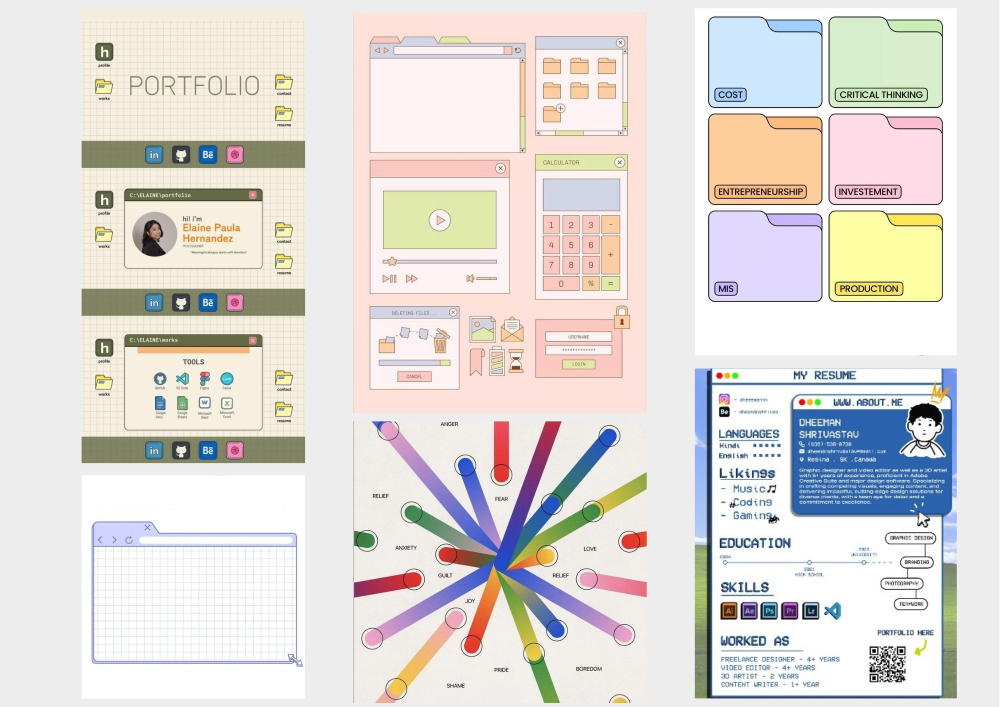
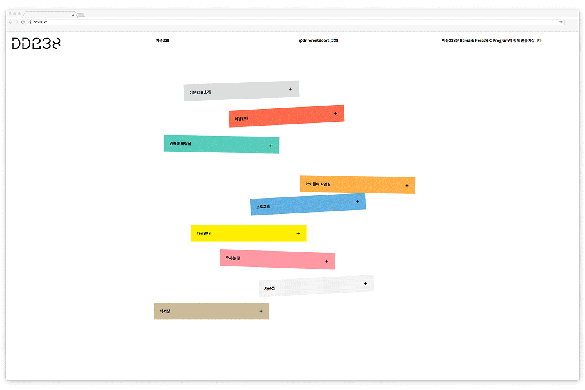

# Examen Interfaces Web

## Avance 1 (9 noviembre)
> Primer avance, hoy presenté todo lo solicitado, el UIKIT no tan avanzado aún, debido a que mientras he ido avanzando en el proyecto, he ido modificando u agregando gamas de colores. Todo lo demás presentado.

### Link Figma

[Isidora-Pérez](https://www.figma.com/design/KJDPJpzLs1xe5z5ICsl9tP/Examen?node-id=0-1&m=dev&t=AzfJgzHKuymWBI34-1)

[Isidora-Pérez](https://www.figma.com/proto/KJDPJpzLs1xe5z5ICsl9tP/Examen?node-id=0-1&t=AzfJgzHKuymWBI34-1)

### Descripción proyecto

Realizaré la página web para mi portafolio, mostrando mis mejores proyectos a lo largo de la carrera. Quiero adoptar una estética tipo escritorio de computador, la cual quiero tomar una gama de colores vibrantes o pasteles y que esta página visualmente se vea atractiva y entretenida. 

La estructura de mi página web la quiero dividir en diferentes secciones, como lo son:

```Principal/inicio:``` En donde se visualizará un tipo de ilustración o interacción (está en veremos) a modo general, además del header con enlace a las siguientes pestañas.

```Proyectos:``` Visualizar proyectos destacados con sus respectivos nombres, mi idea es visualizarlos mediante "carpetas de computador o archivo", los cuales al presionarlos te llevará al proyecto con su respectiva descripción y fotos.

```Sobre mi:``` Acá quiero realizar una interacción o animación, la cual ponga palabras claves de mi persona, ya que actualmente no estoy realizando ningún curso profesional fuera de lo que es la Universidad.

```Contacto:``` Se visualizará un "carpeta de computador" en grande, donde se subdividirá en pequeñas, las cuales mostrarán: instagram, github, correo y linkedin, al momento de presionar en una de esas carpetas, te llevará directamente al enlace.

### Referentes

En la plataforma Pinterest encontré varias referencias de lo visual para mi proyecto. Como lo son paletas de colores, tipos de interacciones, estética, visualidad de las carpetas de computador, iconografía.
 

> *Referentes sacados de pinterest*
 

### Páginas webs

<https://www.awwwards.com/websites/interaction-design/> ⇨ web donde encontré páginas web interactivas bastante útiles e inspiracionales, me sirvió de igual forma para ir viendo la estética y ciertos tipos de diagramación.

<https://bernardita-jesus.github.io/portafolio/index.html> ⇨ en esta página encontré un buen uso de tipografía secundaria, algo más simple que se puede complementar muy bien con mi proyecto para no dar tanta saturación y mejor legibilidad. 

<https://andreas.vision/> ⇨ paletas colores, estética e interacciones

<https://effepinnastudio.com/> ⇨ rescato de esta página sus interacciones, donde la cual el usuario puede ser capaz de modificarla y además usar la plataforma no solo como informativa, si no también de manera lúdica.

<https://uimaven.art/portfolio/> ⇨ siento que esta es un muy buen referente de lo que quiero realizar, solo que aquí implementa mucha interacción, cosa que por el momento no quiero realizar de forma muy profunda, pero muy buena página, el uso del color y la estética de computador y ambiente.

### Correcciones y retroalimentación

Hoy tuvimos retroalimentación de nuestros avances.

Hasta el momento voy bien, cumplí con lo solicitado el día de hoy. La profe me hizo sugerencias a cerca de realizar en vectores el tema de las carpetas estilo computador. Fuera de eso la gama de colores bien y el uso de la tipografía esta bien, ya que se usa bastante en páginas webs y es legible.

---

## Avance 2 (16 noviembre)
> Segundo avance, hoy presenté todo lo solicitado, UIKIT más completo, HTML del home avanzado, wireframes de alta de desktop y mobile avanzados, además de componentes y botones con sus estados.

### Link documentación uso IA

En este link se puede ver de forma detallada el uso de IA, prompts y en qué cosas me ayudó.

[Documentación](https://docs.google.com/document/d/1dHos74jfiwAaoTr0A3vV2uqTAg7ngyvhUz2C7KN9kcc/edit?usp=sharing)

### Wireframe baja

Primero tenía pendiente el ```wireframe baja mobile```, lo quise ir realizando para visualizar qué elementos tenía que cambiar del desktop para que este fuera responsivo.

### Wireframe alta desktop + UIKIT

Luego de realizar este, me fui de lleno a realizar el ```wireframe alta desktop``` solo el inicio si, en donde fui modificando el ```UI kit```, ya que aún no tenía definido del todo, además mientras realizaba ciertos botones en figma, fui definiendo colores, jerarquías, lo cual me llevó a cambiar un poco mi figma de baja y modificarlo también en el de alta. Para que al momento de tener botones con hover, estos fueran más interactivos.

### Botones, componentes, auto layout

Actualmente no recordaba mucho el uso de estos términos y cómo aplicarlo, lo cual recurrí a la IA, la cual me explicó la importancia de estos y como realizar los botones, cambios en sus estados/instancias, importancia auto layout, cómo crear componentes y variantes.

Desde acá en adelante me dió una guía paso a paso sobre cómo realizar el auto layout, componente y variantes, lo cual me resultó mucho más fácil seguir esta guía, la cual luego me fui acostumbrando y pude resolver los demás botones de forma independiente.

### Wireframe alta mobile

Acá ya fui realizando el ```wireframe alta mobile```, lo cual se me hizo mucho más fácil porque fui refrescando la memoria de lo que ya había realizado antes con el de desktop.

### Interacción

En ambos ```wireframes alta``` quería realizar una interacción, la cual más que nada fuese solo interactiva, sin ningún fin de llevar a alguna página, lo cual le fui pidiendo a la IA que me fuera realizando esta, para por mientras introducirla al Figma, la cual a su vez me daba los códigos y la vista previa de cómo se iba a visualizar en la página web. Luego de que me diera la imagen para introducirla a Figma, la inserté y de igual forma podía modificar colores de esta, aunque la mantuve así por el momento, ya que me gustaba la visualidad que le daba al home.

Primero me dió una interacción, la cual no me gustaba visualmente, porque quería que fuera algo más desordenado y no que todo girara en torno al centro. Luego le fui pidiendo cambios hasta llegar a la final. Finalmente llegamos a la interacción final, la cual visualmente era lo que quería, además me dió el archivo ```SVG``` el cual me permite poder modificar esta imagen en Figma.

### Códigos

Al principio comencé con el HTML base del home, donde luego de eso, para poder hacer el código en CSS le solicité ayuda a la IA, debido a que este me cuesta más, de igual forma fui complementando con cosas que ya tenía, además de incluirle la interacción del JS. Además le comenté a la IA que tenía todo visualizado en Figma, lo cual se hizo muchos más fácil. Además le pedí que me implementara la animación/interacción que ya había realizado antes, la cual le había mandado una antes por error y luego le mandé la original para que me la incluyera y así hacer el JS.

### Correcciones y retroalimentación

Hoy tuvimos que entregar más avances sobre nuestras entregas. 

Buenas interacciones y hover. Me sugirieron achicar más los botones, ya que al parecer eran muy grandes y acaparaban mucho espacio de forma visual, además de no delimitar tanto la interacción principal, si no que esta fuera más allá.

Además presenté otra diagramación para los proyectos, por lo cual entre los profes me hicieron decidirme por una, la cual era mejor en términos visuales.

De igual forma me sugirieron solo dejar 3 botones en home, debido a que el botón ```CV``` era bastante visual, que lo dejara en la sección de sobre mi, donde no fuese tan accesible.

### ¿Qué cambié?
- Tamaño botones
- No delimitar interacción principal del home
- Sacar botón CV y dejarlo en el apartado de sobre mí
- Tilde en sobre mí
- Modificar tamaño tipografía en UIkit
  
### Problemas y soluciones

Uno de mis primeros problemas durante el proceso fue el tamaño de los botones, ya que visualmente eran muy grandes. Luego de las correcciones, decidí ir modificando su tamaño, de igual forma se me hizo fácil, ya que como eran solo los botones, estos se modificarían de forma automática en el figma.

### Aprendizajes
