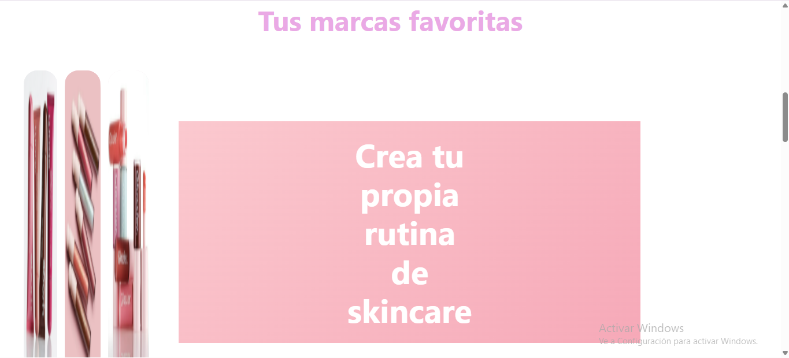
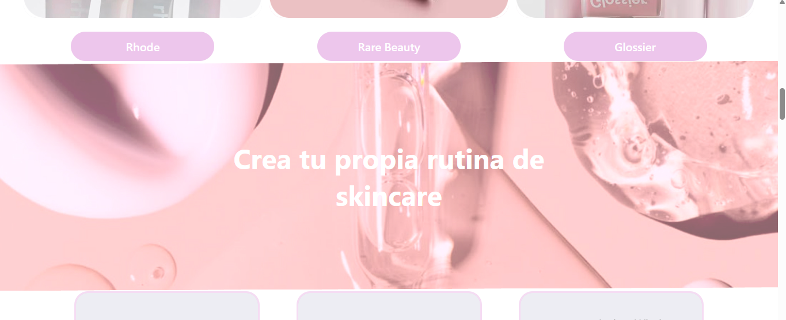

# Bitácora personal - Solemne 02

## Descripción de el proyecto
Aura Glow es un sitio web dedicado a productos de belleza y cuidado de la piel. El objetivo del proyecto fue desarrollar un sitio en HTML y CSS basado en un prototipo realizado en Figma, organizando las diferentes secciones para presentar marcas, productos y contenido relacionado con el skincare.

Durante el proceso trabajé en la estructura HTML, la incorporación de imágenes e íconos y la organización de los distintos elementos de la página. También utilicé ChatGPT como apoyo para resolver dudas, corregir fragmentos de código y comprender cómo incorporar los recursos visuales.

---

# Estructura HTML del sitio

## ¿Qué hice?
Comencé a desarrollar la estructura HTML de Aura Glow tomando como referencia el diseño realizado en Figma. Organicé las secciones principales de la página: encabezado, portada, marcas favoritas, banner de skincare, carrusel de productos, bloques de contenido y pie de página.

Utilicé etiquetas como `header`, `section`, `article` y `footer` para separar el contenido y mantener el código ordenado.

### Estructura
Una de las dificultades fue organizar las distintas secciones dentro de un mismo documento HTML y mantener el orden del diseño. Para resolver mis dudas, utilicé ChatGPT como apoyo para revisar la estructura y comprender dónde incorporar los elementos.

Aprendí que es importante construir primero una estructura HTML ordenada antes de trabajar en los estilos. También comprendí cómo utilizar las clases para identificar las secciones y aplicarles CSS posteriormente.

### Consulta IA 1: Organización de la estructura HTML
**Objetivo:** Organizar el contenido de la página en secciones claras, siguiendo el diseño de Aura Glow.

**Prompt utilizado:**
> Estoy desarrollando un sitio web de una sola página llamado Aura Glow, dedicado a productos de belleza y skincare. Tengo un diseño de referencia realizado en Figma y necesito organizar su estructura en HTML. Ayúdame a ordenar las secciones del sitio, utilizando etiquetas como `header`, `section`, `article` y `footer`. Mantén las clases claras y fáciles de identificar, y no agregues contenido ni secciones que no correspondan al diseño. Por ahora, enfócate solamente en el HTML, porque trabajaré los estilos CSS después.

Utilicé la orientación de la IA para organizar las secciones y mantener una estructura clara, que pudiera seguir editando durante el desarrollo.

---

# Imágenes e íconos

## ¿Qué hice?
Continué completando el contenido visual. Incorporé imágenes para las marcas Rhode, Rare Beauty y Glossier, además de fotografías para los banners y los productos del carrusel.

También agregué los íconos SVG de la bolsa y el corazón en las tarjetas de productos. Organicé los archivos visuales dentro de una carpeta llamada `imagenes` para mantener el proyecto ordenado.

### Incorporación de imágenes
Tuve dudas sobre cómo incorporar las imágenes al HTML y cómo escribir correctamente las rutas de los archivos. También necesitaba reemplazar los emojis iniciales del carrusel por mis propios íconos SVG.

Para resolverlo, consulté a ChatGPT y adapté las sugerencias a los nombres de los archivos de mi proyecto.

Aprendí a utilizar la etiqueta `img`, el atributo `src` para indicar la ubicación de una imagen y el atributo `alt` para describirla. También comprendí que las rutas y extensiones deben coincidir con los archivos reales para que se visualicen correctamente.

### Consulta IA 2: Incorporación de íconos SVG al carrusel
**Objetivo:** Reemplazar los emojis de bolsa y corazón por archivos SVG propios.

**Prompt utilizado:**
> Estoy trabajando en el carrusel de productos de mi sitio Aura Glow. Actualmente, los íconos de la bolsa y el corazón están representados con emojis, pero quiero utilizar mis propios archivos SVG, ubicados en la carpeta `imagenes`, llamados `bolsa.svg` y `corazon.svg`. Modifica únicamente el fragmento HTML de los íconos para incorporar ambos archivos dentro de cada tarjeta de producto. Mantén las clases existentes y utiliza botones con atributos `aria-label` para describir su función. No agregues CSS ni JavaScript todavía, porque los estilos los trabajaré después.

**Código antes:**

```html
<div class="tarjeta-iconos">
  <i>🛍</i>
  <i>♡</i>
</div>
```

**Código después:**

```html
<div class="tarjeta-iconos">
  <button type="button" aria-label="Agregar al carrito">
    
  </button>

  <button type="button" aria-label="Agregar a favoritos">
    
  </button>
</div>
```

Acepté la sugerencia porque me permitió utilizar los íconos del proyecto en lugar de los emojis. Los botones quedaron preparados para recibir estilos con CSS, aunque sus funciones de carrito y favoritos no quedaron implementadas solamente con este código.

### Consulta IA 3: Incorporación de imágenes a las tarjetas de productos
**Objetivo:** Agregar las fotografías correspondientes a los productos del carrusel.

**Prompt utlizado:**
> Necesito incorporar las fotografías de los tres productos de mi carrusel de Aura Glow. Los archivos estarán guardados dentro de la carpeta `imagenes` con estos nombres: `rhode-glazing-milk`, `glossier-super-bounce` y `rhode-pineapple-refresh`. Reemplaza el contenedor vacío de la clase `foto` por una etiqueta `img` para cada producto. Mantén el resto del HTML sin cambios, conserva las clases existentes y agrega textos alternativos descriptivos. 

**Código antes:**

```html
<div class="foto"></div>
```

**Código después:**

```html
<div class="foto">
  
</div>
```

Acepté la sugerencia y repetí el procedimiento para los otros dos productos, utilizando sus respectivas rutas y descripciones.

### Consulta IA 4: Incorporación de imágenes a los bloques de contenido
**Objetivo:** Agregar fotografías a los bloques que acompañan los textos de la página.

**Prompt mejorado:**
> Estoy trabajando en la sección de bloques de contenido de Aura Glow. Tengo cuatro bloques con textos y contenedores vacíos de la clase `foto`. Quiero agregar una imagen a cada uno utilizando archivos guardados en la carpeta `imagenes`: `perfect-match`, `deslumbra`, `tu-rutina` y `autenticidad`. Reemplaza los contenedores vacíos por etiquetas `img` dentro de sus respectivos bloques, agrega textos alternativos descriptivos y conserva el orden, las clases y el contenido original del HTML. No incluyas CSS todavía.

**Código antes:**

```html
<div class="foto"></div>
```

**Código después:**

```html
<div class="foto">
  
</div>
```

Acepté la sugerencia y apliqué el mismo procedimiento en los otros tres bloques, cambiando el archivo y el texto alternativo según su contenido.

---

# Revisión y finalización

## ¿Qué hice?
Completé las principales secciones de Aura Glow y revisé el documento HTML completo. Dejé incorporados los banners, las marcas, las tarjetas de productos, los bloques de contenido y el footer con el formulario de suscripción y los enlaces a redes sociales.

También comprobé que el documento estuviera conectado con la hoja de estilos `estilos.css` y revisé las rutas utilizadas para las imágenes y los íconos.

### Dificultades de revisión
Una de las dificultades fue revisar el código después de agregar varias secciones y numerosos archivos visuales. Para solucionarlo, trabajé por partes y utilicé ChatGPT para revisar fragmentos de HTML y recibir sugerencias de corrección.

También comprendí que tener los elementos escritos en HTML no significa que todas sus funciones estén implementadas. Por ejemplo, las flechas del carrusel necesitan JavaScript para cambiar los productos y el formulario de suscripción necesita una funcionalidad adicional para enviar los datos.

Aprendí que es importante revisar el código durante todo el proceso, comprobar las rutas de los archivos y probar el resultado en el navegador. También comprendí que HTML y CSS cumplen funciones distintas: HTML organiza el contenido y CSS define su presentación visual.

### Consulta IA 5: Revisión del HTML completo
**Objetivo:** Revisar la estructura general del sitio y detectar aspectos que necesitaran corrección.

**Prompt mejorado:**
> Estoy terminando mi sitio web Aura Glow y quiero revisar el HTML completo antes de entregarlo. Analiza el código que te compartiré y comprueba si las etiquetas están correctamente organizadas y cerradas, si las secciones mantienen una estructura coherente y si las rutas de las imágenes parecen estar bien escritas. Identifica posibles errores y señala qué elementos todavía requieren CSS o JavaScript para funcionar. No reescribas todo el sitio si no es necesario: explica las correcciones concretas y conserva mis clases, textos y organización original.

Utilicé las observaciones de la IA como guía para revisar la estructura y distinguir entre los elementos que ya estaban escritos y las funcionalidades que todavía requerían desarrollo.

---

## Errores iniciales durante el desarrollo
Mientras íbamos creando y corrigiendo el código de Aura Glow, aparecieron algunos problemas visuales y de estructura que tuvimos que solucionar.

### Error 1: Imágenes estiradas
Al incorporar las imágenes al sitio, algunas se veían estiradas y no se mostraban como esperábamos.

**Referencia visual:**



Al revisar el código, nos dimos cuenta de que no habíamos cerrado correctamente una sección. El problema se solucionó agregando la etiqueta de cierre `</section>` que faltaba.

### Error 2: Poco espacio entre las secciones
Después de incorporar la siguiente imagen, notamos que quedaba muy pegada a la sección anterior, por lo que la página se veía demasiado junta y necesitaba más espacio visual.

**Referencia visual:**



Agregamos la propiedad `margin-bottom` en CSS para crear una separación entre las secciones.

**Código utilizado:**

```css
section {
  margin-bottom: 5rem;
}
```

Esta propiedad agrega un margen inferior de `5rem` a cada sección, dejando más espacio antes del siguiente contenido.

---

# Reflexión personal

Durante el desarrollo de Aura Glow aprendí a organizar un sitio web de una sola página utilizando HTML y a incorporar imágenes e íconos desde una carpeta propia. También comprendí mejor cómo se relacionan la estructura del código y el diseño que se realiza previamente en Figma.

Una de las dificultades fue corregir y completar algunos fragmentos de código a medida que avanzaba. Para resolver mis dudas utilicé IA como apoyo, revisando las sugerencias y adaptándolas a los nombres de mis archivos y a la estructura del proyecto.

Este proceso me permitió entender que desarrollar un sitio web no consiste solamente en escribir código, sino también en organizar los archivos, revisar los detalles y comprobar que los elementos se muestren correctamente. Además, aprendí que la inteligencia artificial puede ayudar a resolver dudas, pero es importante revisar sus respuestas y comprender los cambios que se incorporan al proyecto.
